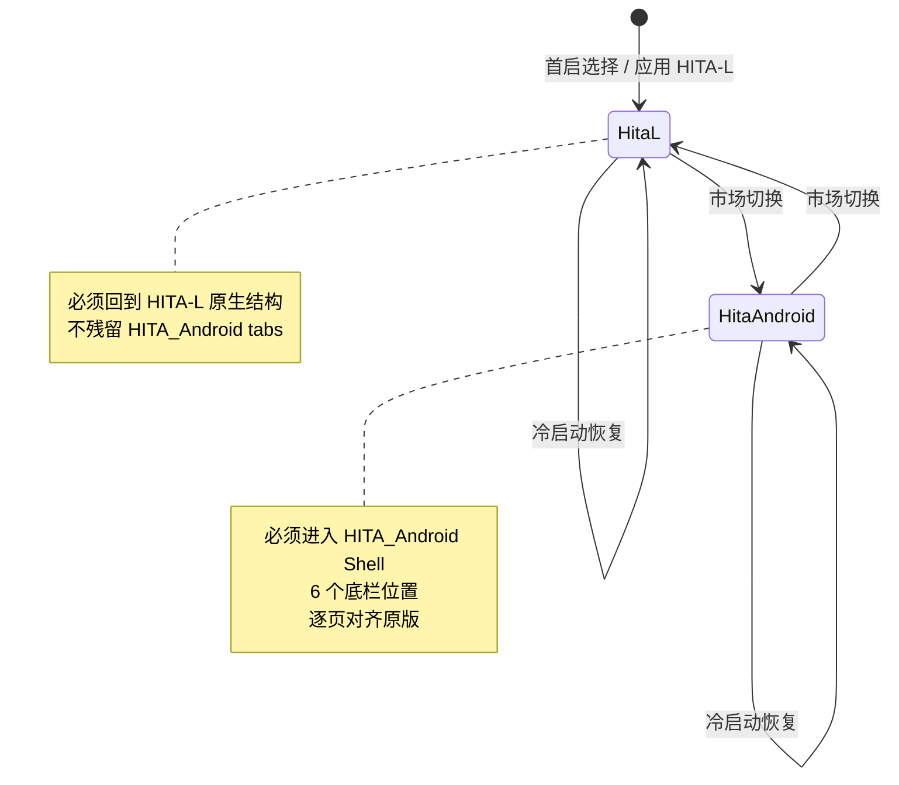

# 7.1 开发需求：整合包切换、HITA_Android UI 对齐与手动 Bug

> 状态：M1–M4 已实现；M4 按用户确认关闭，已接受残差见 §8.2；`v0.7.1` 已发布。  
> 基线：`v0.7.0`（tag `v0.7.0` / 代码提交 `ecdccd6`；master 文档提交 `392e0ed`）  
> 范围：UI 对齐 + 手动使用中发现的缺陷  
> 本文只定义“做什么”和“怎样算完成”，不锁定具体实现方案。

## 1. 本阶段目标

7.1 不新增插件能力，重点解决两类问题：

1. **整合包切换必须产生真实、可持久化的界面变化**：
   - `HITA-L v1.5.3`
   - `HITA Android 3.1.2 复刻`
2. **HITA_Android 整合包的界面必须接近 HITA_Android 3.1.2 原版**：
   - 不是“装了 HITA_Android 的插件，但仍在使用宿主默认四页壳”
   - 不是只换底栏标题/图标
   - 需要页面结构、底栏、字体、间距、颜色、空态和交互入口逐项对齐

## 2. 术语与当前事实

| 术语 | 含义 |
|---|---|
| 宿主默认壳 | `MainActivity` 内置的今日 / 时间表 / 功能中心 / 插件市场结构 |
| HITA-L 壳 | 当前 `active_preset == hita-l-1.5.3` 时走的原生结构 |
| HITA_Android Shell | `PresetShellActivity` 的 Compose 六页结构 |
| 整合包切换 | 在市场里选择 `HITA-L` 或 `HITA_Android`，安装/停用对应插件并更新当前界面 |

当前代码事实：

| 事实 | 位置 / 证据 |
|---|---|
| HITA_Android 整合包声明了 6 个底栏位置：待办、今日、时间表、助手、资讯、更多 | 线上索引 `hita-android-3.1.2.tabs` |
| 线上索引里 HITA_Android 的 `shell` 为 `null` | `presets[].shell` |
| HITA-L 的 `shell` 也为 `null`，`tabs` 为空 | 线上索引 `hita-l-1.5.3` |
| 只有 `activeShell` 非空，`MainActivity` 才会跳到 `PresetShellActivity` | `MainActivity.onCreate()` / `reloadUi` |
| `PresetShellActivity` 曾硬编码 5 个 tab；M3 已改为 6 个（含“资讯”） | `PresetShellActivity.HitaAndroidShell()` |
| M1 时 HITA_Android 曾走 `MainActivity.layoutPages()`；M3 后已固定进入 `PresetShellActivity` | `MainActivity` / `PresetShellActivity` |
| 应用整合包时，只有 `report.canActivate == true` 才会写 active preset 与 tabs | `PluginMarketViewModel.applyPreset()` |
| HITA-L 与 HITA_Android 的视觉差异未达到原版复刻标准 | `docs/porting-status.md` 五页验收记录 |

现有 HITA_Android **Shell 注入基线**五页截图差异（2026-11-18；测试时注入 `active_shell`）：

| 页面 | 内容区差异 | 现有结论 |
|---|---:|---|
| 待办 | 6.36% | 未通过 |
| 今日 | 30.37%（M1 基线；M4 复测 5.36%） | 未通过 |
| 时间表 | 22.63% | 未通过 |
| 助手 | 7.31% | 未通过 |
| 更多 | 28.73% | 未通过 |

这组数字有严格限定，不能直接当作 0.7.0 默认整合包的差异：

- 它来自 M1 时手动注入 `active_shell` 的基线；当时线上 `shell=null` 还走 `MainActivity.layoutPages()`，M3 已改为宿主映射进入 Shell；
- “更多”页测试时 Shell 是已登录态、上游是未登录态，28.73% 包含数据态差异，不是纯 UI 差异；
- 因此这组数字只能说明“注入 Shell 后仍有明显差距”，不能说明当前生产路径的视觉一致度。

7.1 会先按 §5.6 建立状态等价，再重新采集生产路径和 Shell 路径两套基线。旧数字不作为最终阈值；对比方法和最终阈值见 §5.5–§5.8。

## 3. 需求总览



| 编号 | 优先级 | 需求 | 验收摘要 |
|---|---|---|---|
| BUG-001 / R1 | P0 | 整合包切换后必须真实生效，并在进程重启/设备重启后保持 | 切换后当前界面立即变化，冷启动仍一致 |
| BUG-002 / R2 | P0 | HITA_Android 整合包必须呈现 HITA_Android 3.1.2 的界面，而非宿主默认壳 | Shell 激活、6 个 tab、逐页截图通过 |
| R3 | P0 | 切换失败不得产生“半切换”状态 | 必选失败时保留旧整合包与旧界面 |
| R4 | P1 | HITA-L 不能被 HITA_Android 的 Shell/tabs 污染 | HITA-L 回归通过 |
| R5 | P1 | 所有切换状态可诊断、可复现、可回滚 | 导出 `composition.json` + 截图证据 |

## 4. R1：整合包切换必须真实生效且持久化

### 4.1 用户症状

用户报告：

> 切换 HITA-L 和 HITA_Android 后，重启应用没有任何改变。

这是 7.1 的首要缺陷。必须区分以下三种情况并在实现前复现确认：

1. 市场卡片显示“使用中”已切换，但界面没有变化；
2. 界面切换了，但进程重启后回到旧界面；
3. 切换过程实际失败，市场只提示/未提示，旧状态被保留。

### 4.2 功能要求

- **R1.1** 应用一个整合包成功后，当前前台界面必须立即切换到该整合包对应的 UI 形态，不要求用户手动清数据或重装 APK。
- **R1.2** 冷启动（强制停止后打开）必须恢复到最近一次成功应用的整合包，而不是回到首次启动/default 组合。
- **R1.3** 设备重启后同样必须恢复；不得依赖 Activity 内存状态。
- **R1.4** 当前生效状态必须只有一个可信来源，并且以下四项保持一致：
  - 当前 active preset id；
  - 当前 shell / 默认壳选择；
  - 底栏 tabs 列表；
  - 已安装/启用插件集合。
- **R1.5** 重复应用同一个整合包必须是幂等的：不重复追加 tab、不重复安装、不产生重复导航项。
- **R1.6** 切换到 `HITA-L` 后：
  - 不保留 HITA_Android 的 6 个 tab；
  - 不进入 HITA_Android Shell；
  - HITA-L 特有的导航栏颜色、市场入口规则保持现状；
  - HITA_Android 独有的 UI 插件不得继续贡献主界面 tab。
- **R1.7** 切换到 `HITA_Android` 后：
  - 进入 HITA_Android Shell；
  - 底栏固定为 6 个位置，顺序为：待办、今日、时间表、助手、资讯、更多；
  - 不出现“插件市场”等上游不存在的 tab；
  - 旧整合包独有的 tab 不得残留。

### 4.3 失败与回滚要求

- **R3.1** 必选插件下载/校验/安装/启用失败时，不能把新整合包标成“使用中”。
- **R3.2** 失败后旧整合包的 tabs、shell、插件启用状态必须保持可用；不能出现“底栏已经换了但页面打不开”的半状态。
- **R3.3** 失败必须给出可操作的错误文案，并写入诊断：
  - 哪个插件 id；
  - 失败阶段（下载 / sha256 / 安装 / 启用 / 依赖）；
  - 当前 active preset 是否被修改；
  - 是否发生回滚。
- **R3.4** 可选插件失败不阻塞整合包激活，但必须记录并在“已安装插件”中可见。

### 4.4 复现步骤（需求验收用）

```text
1. 全新安装 0.7.0，首次启动选择 HITA-L。
2. 记录：前台 Activity、底栏 tab 数/标题、已启用 UI 插件。
3. 强制停止应用，重新打开，记录同样四项。
4. 进入插件市场，切换到 HITA_Android 3.1.2，等待应用完成。
5. 立即记录四项；强制停止后重新打开，再次记录。
6. 切回 HITA-L，重复第 5 步。
```

验收时必须保存：

- 每次的前台 Activity：`adb shell dumpsys activity activities | grep -E 'mResumedActivity|topResumedActivity'`
- 底栏截图；
- 市场“使用中”状态截图；
- `composition.json`（release 可从关于页导出；debug 可用诊断广播）；
- 相关 `logcat`。

### 4.5 需要重点验证的状态来源

实现前应确认以下三处没有互相覆盖：

- `PresetStateStore`：active preset / active shell；
- `CompositionStore`：saved preset / desired entries / startup outcome；
- `PresetLayoutStore`：当前 tabs。

任何一处写入失败，都必须让最终状态可检测，而不是静默回退到默认壳。

### 4.6 根因待验证清单

以下是需要 M1 用设备状态和 `composition.json` 证实的假设，不是结论：

| 编号 | 假设 | 需要的证据 |
|---|---|---|
| H1 | 应用失败导致 `report.canActivate=false`，`PresetStateStore` / `PresetLayoutStore` 根本没有写入 | 市场错误文案、`composition.json.result`、active preset 时间戳 |
| H2 | active preset 已写入，但 `activeShell` 为空，界面仍走 `MainActivity` 默认布局 | 前台 Activity、`preset_state.xml`、底栏截图 |
| H3 | active preset 与 tabs 已切换，但冷启动被旧的 `desired_entries` 或启动对账覆盖 | 冷启动前后 `composition.json`、`startup_outcome` |
| H4 | 首次切换需要安装 UI 插件，安装失败后旧组合仍然生效，用户看到“没有变化” | 已安装 UI 列表、失败插件 id、sha256/download 日志 |
| H5 | 从 HITA_Android 切回 HITA-L 时，旧 UI tab 没有从布局中移除 | 切换前后 tab 列表、启用的 UI 插件列表 |

M1 必须先确认“卡片使用中状态”“active preset”“前台 Activity”“底栏 tabs”四者到底哪一项没有变化，再决定修状态机还是修渲染路径。

### 4.7 M1 复现结论（2026-11-18）

已在 debug 包复现并确认：

- 干净安装后应用 HITA-L 成功，`active_preset=hita-l-1.5.3`，底栏 3 项；
- 切到 HITA-Android 时，active 仍停在 HITA-L，市场卡片不变成“使用中”；
- `desired_entries` 中仍有 HITA-Android 的 UI 插件，但状态为 `enabled=false, source=PRESET`；
- `applyPreset` 构造的 `userDisabled` 把这些“上一个整合包自动停用”的条目当成用户手动停用；
- `CompositionPlan.blockingRequiredDisabled()` 因此中止，materializer 根本不会执行。
- 另一个独立问题：线上 `hita-android-3.1.2.shell=null`，即使切换成功也仍由 `MainActivity` 渲染，不会进入 Shell。

已落地的修复：

- `preset_disabled` 单独记录“整合包自动停用”的条目，构造 `userDisabled` 时扣除；旧数据从 `desired_entries` 自动还原；
- 用户手动启用/停用插件时清除自动停用标记，保留用户选择优先；
- `active preset / shell / tabs` 改为一次 SharedPreferences `commit()`；
- 旧 `preset_layout` 只在“新布局从未写过”时迁移，避免 HITA-L 的空白布局把旧 6 个 tab 复活；
- 回归测试覆盖 `PresetLayoutCodec` 和自动停用/用户停用的区分。

设备复测：HITA-L → HITA-Android 成功，冷启动保持 6 个 tab；HITA-Android → HITA-L 成功，冷启动回到 3 个 tab。

**M3 进展（2026-11-18）**：已由宿主映射激活 HITA_Android Shell；固定 6 tab；资讯页已接 HOA 资讯与校园通知；市场切换后通过 onResume 立即重定向，两个方向都不再需要冷启动。

**M4 开工（2026-11-18）**：底栏先按上游 `DockMetrics` 收敛为 6×56dp、54dp 高、4dp 内边距、44dp 选中指示器；2026-11-18 实测修正为 6×60dp、54dp 高、贴导航栏（选区输出 dock 24.58%→8.48%），图标改用宿主内置 vector；其余页面结构仍按 M4 逐页对齐。今日已完成首轮结构对齐：蓝色渐变头卡、空闲图标、箭头、空态图标/文案与上游文本 bounds 对齐；探索性内容区差异从 29.25% 降到 5.36%。待办内容区为 3.54%。助手页标题起点/设置图标已对齐，空会话内容区为 3.06%，仍缺输入栏左侧附件按钮。更多页标题和用户卡顶部已对齐到 3px 内；教务功能分组间距、用户头像和课表卡样式调整后，用户头像、课表卡、深浅色按钮、插件市场按钮和“成绩管理/个人成绩明细”双行已补上；标题/用户卡与上游差 1px。第二台 1080×2400 模拟器实测：考试/成绩/个人成绩/空教室/培养方案/深圳课程浏览行文本 bounds 与上游差 1–13px；内容区差异 6.75%，但课表数为 0 vs 1，仍属探索值。但上游有 1 个课表、本地 0 个，数据态不等价，因此不记入正式验收值。时间表页在无课表时已停止渲染假网格，改为真实空态；头部结构已按上游改为月份列、圆形星期/日期和“第N节”标签；用 3 门假课程导入后，标题/日期行与上游 bounds 差 ≤2px。课表网格仍因上游数据不同不做像素值。两者均按 1080×2400、裁掉顶部 130px、底部 310px 排除悬浮 dock、tolerance=10 计算，**不作为验收基线**。截图与 manifest 见 `docs/evidence/7.1/2026-11-18/`。上游未登录只显示 5 个 tab（隐藏“资讯”），本项目按产品决策固定 6 个 tab，因此全图差异不能直接比较；正式验收需登录上游，或对 dock 做独立区域比较。

## 5. R2：HITA_Android 3.1.2 UI 对齐

### 5.1 根因层面的现状

当前“HITA_Android 整合包”与“HITA_Android 原版 UI”不一致，不只是像素问题：

1. 线上预设的 `shell` 为空，宿主不会进入 `PresetShellActivity`；
2. M1 时实际走 `MainActivity.layoutPages()`，用 UI 插件页面拼底栏；M3 已改为固定 Shell；
3. M1 时 `PresetShellActivity` 只有 5 个 tab，预设却声明 6 个，缺少“资讯”；M3 已补齐；
4. 现有 Shell 页面仍是近似实现，不是逐页复刻；
5. 助手页仍缺附件上传、部分资源卡片交互；
6. 主题、状态栏/导航栏、字体栅格化与上游未统一。

因此 7.1 不能只做“把 shell 写进索引”或“把底栏图标换掉”，必须把 Shell 的页面结构和激活链路一起补齐。

### 5.2 激活要求

- **R2.1** 应用 `hita-android-3.1.2` 后，前台必须是 HITA_Android Shell，而不是宿主默认 `MainActivity`。
- **R2.2** HITA-L 不能被误路由到 HITA_Android Shell。
- **R2.3** Shell 的 shell id 必须来自当前预设或稳定的宿主映射，不能只依赖手写 SharedPreferences。
- **R2.4** Shell 激活失败时必须回退到可用壳并提示，不能白屏。
- **R2.5** 从 Shell 切回 HITA-L 后，返回栈中不得还能返回到 HITA_Android Shell 的旧页面。
- **R2.5a（已确认）** HITA_Android 的 6 个底栏位置完全由 Shell 拥有：UI 插件不得增删底栏 tab；插件入口只出现在“更多”或插件市场。
- **R2.5b（已确认）** 安装、卸载、升级 UI 插件不得改变 HITA_Android 的 6 个底栏位置、顺序或图标。

### 5.3 底栏与页面要求

HITA_Android 底栏固定 6 个位置：

| 位置 | 标题 | 页面来源要求 |
|---:|---|---|
| 0 | 待办 | 原版 Homework 结构 |
| 1 | 今日 | 原版今日页 |
| 2 | 时间表 | 原版周网格 |
| 3 | 助手 | 原版 AgentChat 结构 |
| 4 | 资讯 | 原版 `BlogFragment`；M3 已加入 tab，视觉仍待对齐 |
| 5 | 更多 | 原版更多页 |

要求：

- **R2.6** 默认选中页、tab 顺序、标题、图标、选中/未选中颜色与上游一致。
- **R2.7** 底栏尺寸、圆角、阴影、间距、字体行高与上游一致；不得使用占位 glyph 代替正式图标。
- **R2.8（已确认）** 资讯页使用 HITA_Android 3.1.2 原版 `BlogFragment` 的页面结构与视觉；不得用宿主 `com.stupidtree.hita.ui.news` 的页面直接代替。
- **R2.8a** 原版资讯页的数据通过适配层接入；如果现有资讯接口与上游不兼容，优先做数据适配，不改变页面结构。
- **R2.9** 任何 tab 不得出现“页面正在移植”作为最终状态；未完成页面必须在发布前隐藏或完成。

### 5.4 逐页对齐清单

以下清单来自现有移植记录，作为 7.1 的逐页验收基线：

#### 待办

- 标题、日期、周标签的位置与字号；
- 列表卡片底色、行距、分隔线；
- 空态文案与布局；
- 新增/完成/编辑交互入口；
- 与上游同数据状态截图对齐。
- 2026-11-18 登录态复测：标题 bounds 与上游一致（`[42,117][171,208]`），内容区 **0.792%** 达到 ≤2%；但 header 2.12%、dock 8.48%，均未达 ≤1%，**页面整体未通过正式验收**。

#### 今日

- 2026-11-18 复测：内容区 **1.733%**，通过 ≤2%。
- 根因修复：`TodayPage` 原先把 `getTodayEventsSync()` 放在主线程，Room 抛 `Cannot access database on the main thread`，异常被 `runCatching` 吞掉，页面始终空态；现改为 `Dispatchers.IO` 异步加载。
- 已补“全部结束 / 享受生活吧！”状态：课程移出头卡，作为下方时间线卡片渲染；头卡阴影从 14dp 移除。
- 顶部日期格式与字号；
- “享受当下！”/“今天暂无课程或日程安排”等空态；
- 课程卡片高度、圆角、阴影、时间轴；
- 有课/无课两种状态；
- 与上游同数据状态截图对齐。

#### 时间表

- 顶部学期/周标题；
- 星期栏与节次栏；
- 网格起点、行高、列宽；
- 课程卡跨节定位、颜色、文字截断；
- 周切换入口；
- 与上游同课表数据截图对齐。
- 已由节次网格重写为 8:00–20:00 时间轴网格（7 天列、当前列高亮、按时间定位、课程卡）。
- 2026-11-19：构造第 12 周合成 ICS（8/31 周标记 + 11/16–11/19 课程），导入宿主并删除旧课表；等价数据态差异 **11.46%**。
- 修复：导入课表 `code` 为空导致周次恒为 1；课程卡小时仍用 56dp 而网格用 61dp；0–5 点仍高亮前一天（与上游一致）。
- 已接横滑周切换、分享、深浅色；仍缺加课入口和“还有更多课程”提示。

#### 助手

- 顶部标题/会话栏；
- 欢迎卡、输入 dock、发送按钮；
- 消息气泡、Markdown 渲染；
- 附件按钮；
- 资源卡片；
- 登录/未登录、空会话、长消息三种状态；
- 当前 7.31% 的差异不能以“字体栅格化”作为唯一解释。
- 2026-11-18 登录态复测：输入栏左侧“+”和设置图标已对齐，内容区差异 **0.934%**，通过 ≤2% 阈值。
- “+”接入系统文件选择器；文本、PDF、DOCX、XLSX、PPTX 均解析为文本填入输入框（PDFBox + 手写 OOXML SAX，不提高 minSdk）。设备已验证四种格式。图片/视频仍提示待接多模态模型。

#### 资讯

- M3 已加入第 6 个 tab，当前实现 HOA 资讯与校园通知；
- 已确认：使用原版 `BlogFragment` 页面，不直接用宿主 `ui.news` 页面；
- 数据通过适配层接入；
- 已按原版调整 TabRow 容器色、卡片 16/12dp 圆角、标题字号和底部留白；
- 2026-11-18 复测（登录态上游）：1080×2400 内容区差异 79.2% → 11.49%；“资讯”标题 y、TabRow 文本 y 与上游一致，首卡标题/日期 bounds 差 ≤1px；
- 已接上游 LXGW 字体，按 path 做系列分组，同日期按 path 倒序；
- 仍待对齐：卡片边缘/抗锯齿、完整空态/失败态；
- 内部详情阅读页已接 `ShellNewsDetailActivity`，不再跳外部浏览器；
- 正式截图验收仍需登录上游。

#### 2026-11-18 登录态六页基线

- 上游通过 **API 登录**建立会话；API 登录不走 MFA，Web 登录才走短信/OTP。
- 1080×2400，裁剪 top 130 / bottom 310，阈值 10：
  - 待办 3.54%
  - 今日 6.93%（课表数据不同）
  - 时间表 20.60%（真实课表 vs 合成课表）
  - 助手 3.06%
  - 资讯 11.49%
  - 更多 10.61%（上游登录态，宿主未登录）
- 2.0% 阈值均未达到；资讯从 79.20% 收敛到 11.49%，更多结构行高已在独立模拟器验证到 1–13px。
- 不提交上游截图：包含姓名/学号/手机号等个人信息；只记录脱敏比值。

#### 更多

- 顶部 header（主题/抽屉入口）；
- 用户卡登录态；
- 分组标题、行高、左侧圆形图标、右侧箭头；
- 各入口的跳转目标；
- 与上游同登录态截图对齐。

### 5.5 对比基准（基准必须固定）

对比不是“随手截两张图”，而是固定基准后的可复现实验。基准如下：

| 项 | 固定值 |
|---|---|
| 上游基准 APK | `cn.limpu.hita`，`versionName=3.1.2`，`versionCode=2026103101` |
| 被测 APK | `io.github.kajimi16.ohmyhita`，记录 `versionName/versionCode` 与 git SHA |
| 设备 | `emulator-5554`，1080×2400，density 420，Android API 36 |
| 字体 | `font_scale=1.0` |
| 语言 / 主题 | `zh-CN` / 默认浅色 |
| 方向 | 竖屏，固定方向 |
| 动画 | window/transition/animator scale 全部为 0 |
| 状态栏 | 同一时刻、同一系统栏样式；状态栏内容单独记录，不混入主差异比例 |
| 页面状态 | 同一 tab、同一数据状态、同一登录状态（见 §5.6） |

基准 APK 已安装在同一台模拟器上：

```bash
adb -s emulator-5554 shell dumpsys package cn.limpu.hita | grep versionName
# versionName=3.1.2
```

每次验收必须记录上游 APK 版本、被测 APK 版本、设备参数和截图 sha256；版本变了就重新建立基准，不能拿旧截图和新 APK 直接比较。

### 5.6 “同一个界面”的等价条件

“同一个界面”不等于“同一个 tab”，必须同时满足：

1. **同一页面**：例如都在“今日”，不能拿待办和今日比。
2. **同一数据状态**：无课/有课、空待办/有待办、未登录/已登录、空会话/长会话。
3. **同一主题和字体**：浅色/深色、字体缩放、系统栏样式一致。
4. **同一滚动位置**：统一滚到顶部，关闭键盘、弹窗、Toast、下拉刷新。
5. **同一时间条件**：日期、周次一致；动态时钟和通知不参与主差异计算。

状态矩阵至少覆盖：

| 页面 | 必测状态 |
|---|---|
| 待办 | 空列表；有 3 条以上；完成/未完成混合 |
| 今日 | 无课；有课；多课程/跨节 |
| 时间表 | 空课表；有课；跨节课程；周切换后 |
| 助手 | 空会话；多轮会话；资源卡片；附件入口可见 |
| 资讯 | 列表；详情/WebView；空态；加载失败 |
| 更多 | 未登录；已登录；主题/抽屉入口可见 |

数据准备原则：

- 空态和未登录态先用全新安装建立基准，最容易做结构对比。
- 有数据状态必须给上游和被测应用喂**等价数据**；可用同一 ICS、手工录入同一课程，或在隔离的模拟器副本中构造。
- 不得清空用户正在使用的上游 `cn.limpu.hita` 数据来做测试；使用独立模拟器/克隆数据。
- 如果某一状态无法构造等价数据，只能标记“该状态未验收”，不能拿不同状态截图得出差异比例。
- 现有“更多”页 28.73% 的差异中包含登录态不一致；这类数据态差异必须先消除，再进行视觉判断。

### 5.7 截图、差异计算与结构核验

#### 截图

统一从系统层截图，不用手机拍照、不裁通知栏：

```bash
adb -s emulator-5554 exec-out screencap -p > upstream_todo_empty.png
adb -s emulator-5554 exec-out screencap -p > ours_todo_empty.png
```

每张截图必须记录：

- 页面 / 状态；
- 上游或被测版本；
- 设备、density、font_scale；
- 截图时间；
- sha256。

#### 像素差异

使用仓库现有 `scripts/visual_diff.py`：

```bash
python3 scripts/visual_diff.py   upstream_todo_empty.png ours_todo_empty.png   --out diff_todo_empty.png   --crop-top 130 --crop-bottom 130   --tolerance 10
```

当前脚本的计算方式是：

1. 两图必须同尺寸；
2. 按 `--crop-top/--crop-bottom` 裁掉系统栏区域；
3. 对 RGB 逐像素求差，再转灰度；
4. 灰度差 `> tolerance` 的像素计为 changed；
5. 输出 changed pixels / 内容区总像素 = 差异比例，以及差异包围盒和红色热力图。

因此它衡量的是**像素差异 + 差异位置**，不是 SSIM，也不是语义相似度：

- 字体抗锯齿、1px 位移、颜色 1–2 级差异可能被 tolerance 吸收；
- 大块留白相同但结构错误时，比例可能仍然很低；
- 文字内容不同、状态不同也会被算成差异，因此必须先做 §5.6 的状态等价。

仅靠这个比例不能验收。每次对比必须同时输出：

- 全屏差异比例（含系统栏，单独记录）；
- 内容区差异比例；
- 差异包围盒；
- 红色热力图；
- 底栏区域单独裁剪对比（不能只依赖 `--crop-bottom` 后的整图比例）；
- 关键元素的 `uiautomator` 节点/边界；
- 并排图和 50% 叠加图，供人工确认“位置对了但内容错了”或“内容对了但结构错了”。

要求扩展 `visual_diff.py` 支持按区域输出（header / body / bottom tabs），或增加一层包装脚本；区域比例必须出现在验收记录中，而不是只给一个全图数字。

#### 结构核验

像素差异之前先做结构检查：

```bash
adb -s emulator-5554 shell uiautomator dump /sdcard/window.xml
adb -s emulator-5554 pull /sdcard/window.xml ours_todo.xml
```

结构清单：

- tab 数量、顺序、标题、图标、选中态；
- 关键文本、按钮、卡片是否存在；
- 关键元素 bounds 是否在允许偏差内；
- 点击入口是否可点击、跳转目标是否正确。

对于 Compose 页面，`uiautomator` 可能拿不到完整语义节点；这时以截图结构 + 手工点击验证补足，但仍必须至少核对 tab 和关键入口。

### 5.8 验收判定与证据包

判定顺序：

1. **结构通过**：不缺页、不缺 tab、不错位、不出现占位页、状态等价；
2. **像素通过**：内容区差异达到阈值，底栏/header 区域单独达到阈值；
3. **交互通过**：每个 tab 可进入，关键按钮可用，返回栈正确；
4. **回归通过**：HITA-L 三页不高于 0.7.0 基线。

验收阈值（已确认 2026-11-18）：

- 每个页面内容区差异 **≤2.0%**；
- 底栏、header 等关键区域单独 **≤1.0%**；
- 不允许用“抗锯齿”解释结构缺失或错位；
- HITA-L 回归不得高于当前基线（今日 0.55%、时间表 0.53%、功能中心 0.47%）。

每次验收归档：

```text
docs/evidence/7.1/<yyyy-mm-dd>/
  upstream/<page>__<state>.png
  ours/<page>__<state>.png
  diff/<page>__<state>.png
  trees/<page>__<state>.xml
  manifest.json
  report.md
```

`manifest.json` 至少包含：设备参数、上游/被测版本、git SHA、页面状态、截图 hash、差异比例、是否通过、未通过原因。

### 5.9 对比不能证明什么

像素对比只能证明“看起来接近”，不能单独证明：

- 数据绑定正确（可能两边都显示了同一段错误文字）；
- 点击行为正确；
- 动画/滚动/键盘行为正确；
- 深色模式、字体缩放、长文本截断正确。

因此 UI 验收必须与 §8 的功能用例、手工点击和设备截图共同完成；像素比例只是其中一项证据。

### 5.10 实现方式：源码对齐优先，截图像素验收

本次不是对着截图盲调，而是以 HITA_Android 3.1.2 源码为主参考：

| 项 | 基准 |
|---|---|
| 上游源码 | `<workspace>/hita-android-312` |
| 上游提交 | `ac15007` |
| 上游包名 | `cn.limpu.hita` |
| 上游版本 | `versionName=3.1.2` / `versionCode=2026103101` |

每个页面按同一流程处理：

1. **建立源码映射**：列出上游文件、当前移植文件、当前差异。
2. **先恢复结构**：布局层级、组件顺序、底栏、header、间距、字体 token、颜色、圆角、阴影。
3. **再接数据**：保留宿主 `TimetableService` / `HomeworkStore` / Agent 等服务，不直接复用上游数据库；只替换数据源。
4. **再做截图对比**：结构信息对齐后，才用 §5.7 的像素差异定位剩余偏差。
5. **最后做交互回归**：点击、滚动、返回栈、键盘、空态/错误态。

页面映射：

| 页面 | 上游参考文件 | 当前实现文件 |
|---|---|---|
| 主界面 / 底栏 | `ui/main/MainScreen.kt`、`MainTabBar.kt`、`DockMetrics.kt`、`MainTopBar.kt` | `shell/PresetShellActivity.kt` |
| 待办 | `ui/main/homework/HomeworkScreen.kt`、`HomeworkFragment.kt` | `shell/homework/HomeworkScreen.kt` |
| 今日 | `ui/main/timeline/FragmentTimeLine.kt`、`FragmentTimelineViewModel.kt` | `shell/PresetShellActivity.kt` 的 `TodayPage` |
| 时间表 | `ui/main/timetable/TimetableScreen.kt`、`TimetableWeekView.kt`、`TimetableGridGeometry.kt` | `shell/PresetShellActivity.kt` 的 `TimetablePage` |
| 助手 | `ui/main/agent/AgentChatFragment.kt`、`AgentChatViewModel.kt` | `shell/agent/AgentChatScreen.kt` |
| 资讯 | `ui/main/blog/BlogFragment.kt`、`BlogViewModel.kt` | `shell/news/ShellNewsPage.kt`（功能已接，视觉待对齐） |
| 更多 | `ui/main/navigation/NavigationFragment.kt`、`NavigationViewModel.kt` | `shell/PresetShellActivity.kt` 的 `MorePage` |

已知源码差异示例（不是最终结论）：

- 当前 `HomeworkScreen.kt` 在移植时额外加了“待办”标题、改了顶部 padding 和星期文案；这些改动必须和上游父级 header 一起核对，不能把“差异”当“改进”。
- 当前 `AgentChatScreen.kt` 相比上游 `AgentChatFragment.kt` 删减了大量附件、会话栏、草稿/滚动/键盘处理；助手页必须回到上游结构补齐，而不是只调气泡颜色。
- 当前 `PresetShellActivity` 的底栏是手写 5 个 `ShellTab`，上游是 `MainTabBar` + `DockMetrics` 的 6 tab 结构；底栏应优先按上游结构重做。

约束：

- 不复制上游数据库、包名、登录态或私有实现；
- 不为了让截图好看而隐藏页面内容、缩小文字或删除 tab；
- 源码结构与截图冲突时，以“上游结构 + 状态等价”为准，截图差异用于定位而不是替代判断。

实现按页提交，每页单独给出：源码 diff 摘要、结构清单、截图差异、未消除差异原因。这样即使某一页暂时不达标，也不会把整包 UI 一起阻塞。

## 6. R4：HITA-L 回归要求

- **R4.1** 切换回 HITA-L 后，页面结构、底栏、导航栏颜色、市场入口规则与 0.7.0 基线一致。
- **R4.2** HITA-L 不安装/不启用 HITA_Android 专属 UI 插件作为主界面 tab。
- **R4.3** HITA-L 的既有三页截图差异不得回退。
- **R4.4** HITA-L 与 HITA_Android 的切换必须可逆，不要求清数据。

## 7. 手动 Bug 登记

### BUG-001：整合包切换在重启后不生效

| 字段 | 内容 |
|---|---|
| 优先级 | P0 |
| 现象 | HITA-L 与 HITA_Android 切换后，重启应用没有变化 |
| 期望 | 切换后立即变化；冷启动/设备重启后保持最后一次成功切换 |
| 当前证据 | 用户手动使用反馈；代码层存在 active preset / shell / tabs 三套状态 |
| 需要补充 | 失败时的市场提示、`composition.json`、前台 Activity、底栏截图 |
| 关联需求 | R1、R3 |

### BUG-002：HITA_Android 整合包与原版视觉几乎未对齐

| 字段 | 内容 |
|---|---|
| 优先级 | P0 |
| 现象 | HITA_Android 整合包看起来仍像宿主默认 UI / 插件拼装页 |
| 期望 | 进入 HITA_Android Shell，6 个固定 tab，逐页接近原版 |
| 当前证据 | M1：`shell=null`、Shell 仅 5 tab、差异 6.36%–30.37%；M3 已激活 6 tab，M4 今日内容区降到 5.36% |
| 需要补充 | 原版同页截图、设备型号、字体缩放、登录状态、数据状态 |
| 关联需求 | R2、R4 |

### 已确认的产品决策（2026-11-18）

- HITA_Android 的 6 个底栏 tab 由 Shell 固定提供；UI 插件不得增删底栏 tab，插件入口放到“更多”或插件市场。
- 资讯页使用原版 HITA_Android 3.1.2 `BlogFragment` 的结构与视觉，数据通过适配层接入。
- 视觉阈值：内容区 ≤2.0%，底栏/header 等关键区域 ≤1.0%。

### 其他已知差距（是否纳入 7.1 待确认）

这些来自现有移植记录，不一定是用户本次手动发现的 bug：

- 助手附件上传/资源卡片；
- 资讯页不存在；
- 更多页 header 主题/抽屉按钮；
- 深色模式、字体缩放、系统栏颜色；
- 无网络/索引加载失败时的市场与 shell 回退；
- 跨进程/进程被杀时的 UI 插件安装原子性。

### 新增手动 Bug 模板

后续手动发现的 bug 按以下格式追加：

```text
### BUG-XXX：短标题
- 优先级：
- 版本 / 整合包：
- 设备 / Android：
- 前置数据状态（登录、课表、主题、字体缩放）：
- 复现步骤：
- 期望：
- 实际：
- 截图 / 录屏：
- 日志 / diagnostics：
```

## 8. 验收用例

| 编号 | 场景 | 期望 |
|---|---|---|
| SW-01 | HITA-L → HITA_Android，立即查看 | 进入 HITA_Android Shell，6 个 tab，active 状态正确 |
| SW-02 | SW-01 后强制停止再打开 | 仍是 HITA_Android Shell，6 个 tab 顺序不变 |
| SW-03 | HITA_Android → HITA-L，立即查看 | 回到 HITA-L 结构，无 HITA_Android tabs |
| SW-04 | SW-03 后强制停止再打开 | 仍是 HITA-L，不回到 HITA_Android |
| SW-05 | 设备重启后打开 | 保持最后一次成功应用 |
| SW-06 | 连续应用同一整合包两次 | 无重复 tab、无重复安装、状态不变 |
| SW-07 | 必选插件缺失/下载失败 | 旧整合包保持可用，新整合包不显示“使用中”，有错误诊断 |
| SW-08 | 离线启动 | 使用已安装插件恢复，不清空当前组合 |
| SW-09 | HITA_Android 下安装/卸载一个 UI 插件 | 底栏仍是固定 6 tab，顺序/图标不变 |
| UI-01 | 待办页同数据对比 | 结构一致，差异达到阈值 |
| UI-02 | 今日页有课/无课 | 两种状态均通过 |
| UI-03 | 时间表页同课表 | 网格、课程卡、周标题通过 |
| UI-04 | 助手页空会话/长会话 | 标题、欢迎卡、输入 dock、消息气泡通过 |
| UI-05 | 资讯页 | 可进入，列表/详情/空态/失败态通过 |
| UI-06 | 更多页登录/未登录 | header、用户卡、分组、图标通过 |
| UI-07 | 系统栏/字体缩放 | 无错位、无截断、无颜色回退 |
| REG-01 | HITA-L 三页回归 | 不差于 0.7.0 基线 |

### 8.1 M4 当前阻塞（2026-11-18 更新）

- **正式基线**：上游已通过 API 登录，六页已抓取；API 登录不走 MFA，Web 登录才走短信/OTP。
- **内容区通过（页面未正式通过）**：待办 0.792%、助手 0.934%、今日 1.733%。header/dock ≤1% 只对待办做了分区测量，未通过；其他两页关键区未测。
- **时间表**：已改为 8:00–20:00 时间轴网格，结构差异 20.60%→13.53%；fixture 仍是第 1 周/测试课程，与上游第 12 周/真实课程不等价，需等价 fixture 和周切换/顶部操作。
- **更多**：第二台 1080×2400 模拟器已建立等价态（上游未登录 0 课表 + 宿主未登录 0 课表），内容区差异 10.61%→**6.25%**；仍剩字体/图标/卡片像素差，未达 2%。
- **资讯**：已接 LXGW 字体和系列分组，11.49%；剩卡片边缘/抗锯齿、空态/失败态。
- **助手附件**：文本/PDF/DOCX/XLSX/PPTX 已接；图片已用测试 Key 实际验证（模型正确描述纯蓝图片）；视频请求仍返回 **HTTP 429**（限流/额度），视频理解未验收。
- **验收证据**：`docs/evidence/7.1/2026-11-18/` 仍是旧的登录前三页数据，需补资讯/更多/时间表和 header/dock 独立比例；`visual_diff.py` 尚无分区输出。
- **分区阈值**：待办页 header 2.12%、body 0.639%、dock 8.48%（修 dock 前 24.58%），header/dock 均未达 ≤1%；`visual_diff.py` 已支持 `--header-bottom/--dock-top`。
- **回归**：HITA-L 三页视觉回归、M5、0.7.1 发布候选未完成。

这些阻塞中，更多/时间表需要等价数据或登录态；其余是验收与附件契约工作。

### 8.2a 资讯残差验收（2026-11-19）

- 用户确认接受资讯页 11.02%–11.36% 残差，不再做卡片边缘/抗锯齿调优。
- 不声明资讯页达到 2% 阈值；差异集中在卡片边缘，文字/结构已对齐。
- A1 关闭。

### 8.2b B2/C2 验收口径（2026-11-19）

- B2：图片多模态已真实验证并通过；视频连续 HTTP 429。用户确认接受“仅图片”，视频记为 provider-429 已知缺口，不声明视频理解通过。
- C2：字体 0.85/1.3、深色、待办 3+/混合、资讯失败/恢复、今日空/多课、时间表空、助手多消息均已归档。用户确认接受当前矩阵；资讯空态、更多登录态、大量文本长会话保留为已知缺口。
- 两项按上述口径关闭，不重定义为“全量通过”。

### 8.3 深色模式（2026-11-19）

- `PresetShellActivity` 根主题改为 `isSystemInDarkTheme()` 的 light/dark ColorScheme。
- 页面背景、卡片表面、主/次文本、图标、dock 选中态改用 Material token；蓝色品牌卡和课程卡白字保持不变。
- 资讯页此前硬编码白底，已单独 token 化。
- 深色冒烟：待办、今日、时间表、助手、资讯、更多六页可读；切回浅色后资讯页与改动前 **0.000%** 差异。
- 2026-11-19 修正：`shellSecondary/shellTertiary` 曾被全局替换成自递归，导致 host 启动 StackOverflow；已改回字面色值（`60b6aa7`）。
- 修正后在宿主上实际验证 dark More/Today/News；不是上游截图。
- 字体缩放：0.85/1.3 六页冒烟；1.3 下 More 固定行高重叠已改为 `heightIn(min=...)`。
- 仍未做：上游深色逐页像素验收、系统栏颜色逐项对齐、完整状态矩阵。

### 8.2 M4 验收结论（2026-11-18）

- 用户确认：在没有可靠、非过拟合改动的前提下，接受当前结果，停止 header/dock 像素调优。
- 内容区：待办 0.792%、助手 0.934%、今日 1.733%；资讯 11.49%、更多 10.61%、时间表 13.53%。
- 关键区（待办实测）：header 2.123%、dock 8.484%。这些是**已知并接受的残差**，不声明达到 1% 阈值。
- M4 关闭；后续作为 backlog 处理：资讯/更多/时间表的等价数据、完整 PDF/Office/媒体附件、HITA-L 回归、M5 与 0.7.1 发布候选。

## 9. 里程碑划分

| 里程碑 | 内容 | 输出 |
|---|---|---|
| M1 复现与诊断 | 复现 BUG-001；确认 active/shell/tabs/插件四态 | 复现记录、`composition.json`、问题定位；已完成 2026-11-18 |
| M2 切换状态机 | 统一 active preset、shell、tabs、插件状态；冷启动恢复 | 状态持久化与双向切换已通过；Shell 接管待 M3 |
| M3 Shell 激活与六 tab | HITA_Android 进入 Shell；补资讯；移除占位页 | 已可进入固定 6 tab；资讯页功能已接；M4 做视觉 |
| M4 页面视觉对齐 | 待办/今日/时间表/助手/资讯/更多逐页 | 每页截图与差异报告 |
| M5 回归 | HITA-L / 插件市场 / 首次启动 / 冷启动 | 发布候选 0.7.1 |

## 10. 非目标

以下不在 7.1 首轮范围内，除非单独确认：

- 新增 Agent 工具或修改模型/后端；
- 重写插件市场索引协议；
- 新增第三方插件生态能力；
- 将 HITA-L 也改造成 Compose Shell；
- HITA_Android 的逐像素字体/抗锯齿完全一致；
- 为旧整合包做数据迁移之外的大规模数据兼容。

## 11. 已确认与待确认问题

已确认（2026-11-18）：

- **视觉阈值**：每个页面内容区差异 ≤2.0%；底栏、header 等关键区域单独 ≤1.0%。
- **底栏归属**：HITA_Android Shell 固定提供 6 个 tab；UI 插件不得增删底栏 tab。
- **资讯页**：使用原版 HITA_Android 3.1.2 `BlogFragment`，数据通过适配层接入。

待确认：

1. **HITA-L 的准确底栏结构**：以当前 0.7.0 行为为基线，还是以 HITA-L 原版截图为基线？
2. **设备范围**：只要求 1080×2400 / Android 36 模拟器，还是需要指定真机？
3. **其他手动 bug**：请按 §7 模板补充现象、步骤、截图与日志。

## 12. 变更影响面（规划用）

预计涉及但不限于：

- `app/src/main/java/com/stupidtree/hitax/market/`：preset active、layout、composition 状态；
- `app/src/main/java/com/stupidtree/hitax/ui/main/MainActivity.kt`：壳选择与返回栈；
- `app/src/main/java/com/stupidtree/hitax/shell/PresetShellActivity.kt`：六 tab、资讯、页面路由；
- `app/src/main/java/com/stupidtree/hitax/shell/homework/`：待办页；
- `app/src/main/java/com/stupidtree/hitax/shell/agent/`：助手页；
- `app/src/main/java/com/stupidtree/hitax/ui/`：今日/时间表/更多页；
- `market` 分支索引：`hita-android-3.1.2.shell` 与 tabs；
- `docs/porting-status.md`：逐页验收记录；
- `scripts/visual_diff.py`：截图对比证据。

M1/M2 已完成；M3 的 Shell 激活、固定 6 tab 与资讯入口已落地；下一步进入 M4 逐页视觉对齐。
