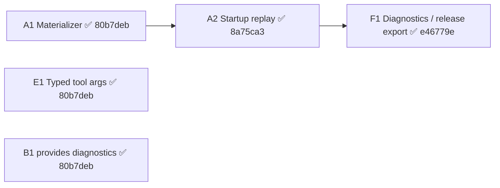

# 插件架构剩余工作：可执行拆分

> 基线：`e46779e`（2026-11-18）
> 目标：把 `docs/plugin-roadmap.md` 中尚未完成的部分拆成 Dumate 可直接执行的任务卡。
> 纪律：只改任务卡点名文件；不引入 YAML / JS 解释器 / 通用事件总线 / 第二套工具注册表；不卸载用户设备上的包。

## 0. 当前状态

已完成并合入：

- **A1** `CompositionMaterializer` — `80b7deb`
- **A2** 启动时按 active preset 重放 — `8a75ca3`
- **E1** 14 个 ReAct 工具参数对象化 — `80b7deb`
- **B1** `provides` 声明/实际差异诊断 — `80b7deb`
- **F1** release 诊断导出 + 诊断元数据 + builtin 索引守卫 — `e46779e`

五张任务卡均已完成。剩余事项：

| 事项 | 状态 |
|---|---|
| 真机整合包切换冒烟 | 内置演示索引没有 preset，需要真实索引或测试索引 |
| AI 资源卡片交互 | 需要登录/API Key |
| UI 安装跨进程事务 | 已做旧 APK 备份/恢复，但进程被杀时仍非跨进程事务 |

## 1. 工作流 DAG



任务卡执行顺序已完成；剩余只有设备环境相关的冒烟补充。

## 2. A1：CompositionMaterializer ✅ 80b7deb

### 目标

把“准备 artifact”从 `CompositionReconciler.execute` 的 executor 中拆出：

```text
resolve(plan) -> materialize(required/optional) -> reconcile
```

materialize 阶段只下载、校验、落到 staging；reconcile 阶段只 swap/attach/enable/disable，不再访问网络。

### 涉及文件

- `app/src/main/java/com/stupidtree/hitax/market/Composition.kt`
- `app/src/main/java/com/stupidtree/hitax/market/CompositionStore.kt`
- `app/src/main/java/com/stupidtree/hitax/market/PluginInstaller.kt`
- `app/src/main/java/com/stupidtree/hitax/market/PluginMarketViewModel.kt`
- `app/src/main/java/com/stupidtree/hitax/uiplugin/UiPluginManager.kt`
- `app/src/test/java/com/stupidtree/hitax/market/CompositionReconcilerTest.kt`
- 新增 `app/src/test/java/com/stupidtree/hitax/market/CompositionMaterializerTest.kt`

### 实现步骤

1. 在 `market` 增加：
   ```kotlin
   sealed interface PreparedArtifact {
       data class Ui(val entry: UiMarketPlugin, val file: File, val sha256: String) : PreparedArtifact
       data class Dex(val entry: MarketPlugin, val stagedDex: File) : PreparedArtifact
   }

   interface CompositionMaterializer {
       fun prepare(kind: CompositionKind, id: String): Result<PreparedArtifact>
       fun cleanup()
   }
   ```
2. 拆 `PluginInstaller.install(entry, indexBase)`：
   - `prepare(entry, indexBase): PreparedDex`：下载到 `.staging-<id>/plugin.dex`，校验 `sha256`，**不卸载旧插件、不改 `installed.json`**。
   - `attach(prepared: PreparedDex)`：执行原来的 backup/swap/load/save 逻辑。
   - 保留 `install()` 作为 `prepare + attach` 的兼容包装，避免其它调用点一次改完。
3. UI 准备：
   - ViewModel 的 `installUiBlocking` 拆成 `prepareUi(entry, indexBase): File` 与 `attachUi(entry, file)`。
   - `UiPluginManager.installFile` 保持“接收已校验文件”的语义，不再负责下载。
4. `applyPreset`：
   - resolver 产出 plan 后，先处理所有 `CompositionAction.Install`。
   - `BUILTIN` 没有 artifact：不经过 materializer，直接由 `BuiltinPluginManager.setEnabled(true)` 处理。
   - `DEX` / `UI` 才需要 prepared artifact。
   - required 准备失败：不进入 reconcile，已有组合保持原样。
   - optional 准备失败：跳过该 install，计入 `optionalFailures`，继续。
   - `CompositionExecutor.install` 从 prepared map 取文件，不访问网络。
5. `cleanup()` 必须在成功、失败、取消路径都清理 staging 目录。

### 验收

```bash
./gradlew :app:testDebugUnitTest --tests "*Composition*"
./gradlew :app:testDebugUnitTest --tests "*PluginInstaller*"
```

- required 下载失败：`PresetStateStore.activeId` 不变，旧插件仍 enabled。
- optional 下载失败：新组合 required 仍可完成，report 记录 optional。
- 成功路径：staging 清空，`installed.json` 与 `ui_plugins` 记录完整。
- 不出现“下载全部成功但旧组合已被 disable”的中间状态。

## 3. A2：启动时按 active preset 重放 ✅ 8a75ca3

### 目标

保留现有启动装配，在其**之后**追加一次组合对账：

```text
installAllWithDescriptors + PluginInstaller.restore()
  -> active preset + saved plan + cached index + current state
  -> resolve startup plan
  -> 只处理已安装/已具备 artifact 的条目
  -> reconcile enable/disable
```

顺序不能反过来：replay 放在 builtin/dex 恢复之前时，`BuiltinPluginManager.rows()` / `host.isInstalled()` 还是空的，reconcile 会变成 no-op。

启动期**不下载**。缺 required artifact 时保持当前可用状态并写诊断，不阻塞启动。

### 涉及文件

- `app/src/main/java/com/stupidtree/hitax/HApplication.kt`
- `app/src/main/java/com/stupidtree/hitax/market/CompositionStore.kt`
- `app/src/main/java/com/stupidtree/hitax/market/MarketSources.kt`
- `app/src/main/java/com/stupidtree/hitax/market/IndexCache.kt`
- `app/src/main/java/com/stupidtree/hitax/market/Composition.kt`
- 新增 `app/src/main/java/com/stupidtree/hitax/market/CompositionStartup.kt`
- 新增 `app/src/test/java/com/stupidtree/hitax/market/CompositionStartupTest.kt`

### 实现步骤

1. `CompositionStore` 保存结构化 applied preset（已有 `savedPreset`）与最近一次 plan 的 `desired` 条目；不要依赖 `composition.json` 文本反序列化。
2. 新增纯函数：
   ```kotlin
   data class StartupDecision(
       val plan: CompositionPlan,
       val canReconcile: Boolean,
       val skipped: List<CompositionMissing>,
   )

   fun planStartup(
       savedPreset: MarketPreset?,
       livePreset: MarketPreset?,
       available: Map<CompositionKind, Set<String>>,
       installed: Map<CompositionKind, Set<String>>,
       enabled: Map<CompositionKind, Set<String>>,
       userDisabled: Map<CompositionKind, Set<String>>,
       killSwitches: Set<CompositionTarget>,
   ): StartupDecision
   ```
3. startup plan 只允许对已 installed 的条目 enable/disable；`NotInstalled` / `NotInIndex` 不进入 install。
4. `HApplication` 在 `installAllWithDescriptors(...)` 与 `PluginInstaller.restore()` **完成之后**：
   - 读取 applied preset + cached index；
   - 如果 `canReconcile=false` 或没有 saved preset：保持现有启动结果；
   - 如果可重放：执行 `CompositionExecutor` 的 enable/disable；启动期不 install DEX/UI。
   - `BUILTIN` 的 `CompositionAction.Install`（若出现）只调用 `BuiltinPluginManager.setEnabled(true)`，不经过 materializer。
5. 启动失败只写 `PluginDiagnostics`/`composition.json`，不抛到 `onCreate` 外层。

### 验收

```bash
./gradlew :app:testDebugUnitTest --tests "*CompositionStartup*"
./gradlew :app:testDebugUnitTest --tests "*Composition*"
```

- 有 saved preset、文件已安装：builtin/dex 恢复后 old-only UI/builtin 被停用，目标条目启用。
- builtin 在此阶段能被实际 enable/disable（因为 `host.isInstalled` 已由前序装配填充），不是 no-op。
- 缓存索引缺失：不 crash、不 disable 当前可用组合，写 missing 诊断。
- 安全开关生效：被 kill-switch 的条目既不被启动启用，也不会在失败回滚中复活。
- 设备冷启动两次，第二次状态与第一次一致（幂等）。

## 4. E1：ReAct 工具参数对象化 ✅ 80b7deb

### 目标

从“schema 校验 + 工具自己正则解析字符串”迁移到“registry 解析一次 JSON，工具读取参数对象”。

### 涉及文件

- `app/src/main/java/com/stupidtree/hitax/agent/tools/ToolContract.kt`
- `app/src/main/java/com/stupidtree/hitax/agent/tools/ReActTool.kt`
- `app/src/main/java/com/stupidtree/hitax/agent/tools/ReActToolRegistry.kt`
- `app/src/main/java/com/stupidtree/hitax/agent/tools/*Tool.kt`（14 个工具）
- `app/src/main/java/com/stupidtree/hitax/agent/llm/ShellChatService.kt`
- `app/src/test/java/com/stupidtree/hitax/agent/tools/ReActToolRegistryTest.kt`

### 实现步骤

1. 在 `ReActToolInput` 增加：
   ```kotlin
   val arguments: JsonObject = JsonObject()
   ```
   保留 `actionInput` 一个版本作为兼容字段，但 registry 只把已解析结果填进 `arguments`。
2. `ToolCall` 增加 `arguments: JsonObject`；`runPipeline` 只解析一次。
3. 14 个工具按以下顺序迁移：
   - 单参数：`search_teacher`、`search_timetable`、`search_course`、`search_external_resource`、`web_search`、`rag_search`、`crawl_status`
   - 多参数：`get_course_detail`、`crawl_page`、`crawl_site`、`search_empty_classroom`、`add_activity`、`submit_review`
   - 无参数：`get_timetable`
4. 工具不再用 `Regex("\"key\"...")` 解析 `actionInput`；统一 `arguments.get("key")` + 默认值。
5. `catalog()` 可继续生成人类可读目录；新增一个 JSON Schema 生成函数供测试/未来模型使用，但不要改现有提示词格式。
6. 保留原始字符串兼容仅限 `allowRawString` / 零参数工具。

### 验收

```bash
./gradlew :app:testDebugUnitTest --tests "*ReActToolRegistry*"
./gradlew :app:testDebugUnitTest --tests "*Tool*"
```

- 每个工具至少一个“正确参数执行”测试和一个“缺必填/错类型”测试。
- `ReActToolInput.actionInput` 不再被 14 个工具直接读取。
- `submit_review` 明确意图 guard 仍生效。
- 资源卡片仍能从 `search_course` / `search_external_resource` 进入 `ToolExecution.cards`。

## 5. B1：`provides` / `onServiceLost` 的取舍 ✅ 80b7deb（方案 A）

### 目标

消除死元数据，二选一，不允许继续悬挂：

- **方案 A（推荐，低风险）**：保留 `requires`，删除/文档降级 `provides`，说明它只是清单提示，不参与激活。
- **方案 B**：实现 `onServiceLost` 观察回调与 `provides` 预检；需要 API 版本递增、ABI 重新生成、文档变更。

### 方案 A 最小改动

- `PluginDescriptor.provides` 保留兼容字段，但在 `PluginDiagnostics` 增加 `declaredProvides` 与 `actualProvides` 的差异提示，或明确注释“不参与调度”。
- 不新增 `PluginContext` 成员，不升 API 版本。

### 方案 B 验收

- 卸载 provider 后，consumer 仍在 `installed`，诊断 `degraded` 可见，并触发一次只读回调。
- 回调异常不影响卸载。
- `HITA_API_VERSION` 递增，`api-abi.txt` 重生成，`verifyApiAbi` 通过。

## 6. F1：诊断元数据与 release 导出 ✅ e46779e

### 目标

- `PluginDiagnostics.installed` 增加 `origin`、`version`、`requires`、`provides`。
- release 包增加“导出诊断”入口，写出 `diagnostics.json` + `composition.json`；不依赖 debug 广播。
- `verifyMarketIndex` 增加 builtin `requires`/`provides` 是否是已知 `ServiceKey.name` 的校验。

### 涉及文件

- `kernel/src/main/java/com/stupidtree/hita/kernel/PluginDiagnostics.kt`
- `kernel/src/main/java/com/stupidtree/hita/kernel/PluginHost.kt`
- `app/src/main/java/com/stupidtree/hitax/HApplication.kt`
- 设置页/关于页对应 Compose 文件
- `app/build.gradle`
- `app/src/main/assets/plugins.json`

### 验收

```bash
./gradlew :verifyMarketIndex :verifyPluginBoundary :verifyApiAbi
./gradlew :kernel:test :app:testDebugUnitTest
```

- diagnostics JSON 含 installed source/version/descriptor。
- release 设置页可导出，文件可被 `json.load` 解析。
- builtin 未知 `requires/provides` 会让 `verifyMarketIndex` 失败并指出条目。

## 7. 禁止事项

- 不执行 `adb uninstall` 验证当前构建；设备验证优先用显式广播和覆盖安装。
- 不把 `:app` 类型引入 `:api`；插件工具只使用 `PluginToolSpec` / JSON 字符串。
- 不新增第二套工具注册表、通用事件总线、YAML/JS 配置。
- 不改已有 preset 存储格式；新增字段必须向后兼容。
- 任何 `:api` 公开签名变化：先判断二进制兼容，必要时升 `HITA_API_VERSION`，再跑 `:verifyApiAbi`。

## 8. Dumate 交付格式

每个任务单独发给 Dumate，附：

```text
Baseline: e46779e
Task: A1 / A2 / E1 / B1 / F1（只做一张卡）
Read: docs/plans/2026-11-18-plugin-remaining-work.md
Rule: 不改任务卡外文件；不执行 adb uninstall；不跳测试
Verify: 任务卡里的命令 + 相关单测
Report: 改动文件、验证命令、失败证据、剩余风险
```

所有任务卡已完成：

- 不要把 A1/A2/E1/B1/F1 再次发给 Dumate。
- 如需继续，只补设备冒烟或新一轮审计发现。
