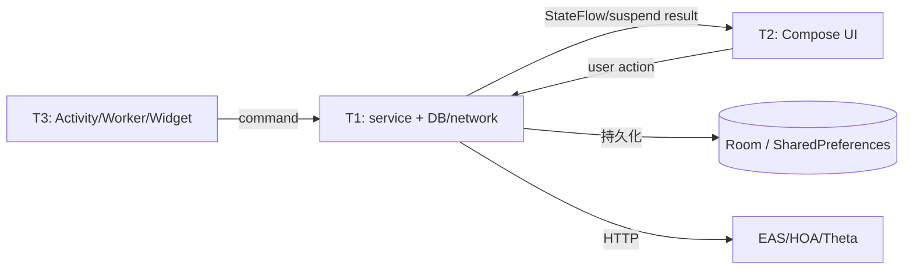

# timetable / eas / resource / user / theta 的 T1/T2/T3 拆分

## 1. 约束

Android 的硬边界决定了不能把 DeepSeek Harness 的 Cordis 模型直接照搬：

- T1 逻辑插件只能声明一个无参 `Plugin`，不能注册 Activity、Service、Receiver、Provider，不能携带资源。
- T2 界面插件只能通过宿主 `PluginUiActivity` 的 Compose 容器渲染，不注册组件、不合并资源。
- T3 是宿主特权层，负责 Room 初始化、Activity、通知、Worker、Widget、权限与外部 Intent。
- 所有插件依赖 `:api` 的稳定契约；T1 需要 Android Context 时只拿 `HostEnvironmentService` 的 `applicationContext`。

## 2. 目标模块

| 业务 | T1 核心 | T2 界面 | T3 特权层 | 现有代码 |
|---|---|---|---|---|
| timetable | 课表数据库、ICS、同步、`TimetableService` | 周视图、课程详情、增删改 | Widget、提醒、前台服务、Room 生命周期 | `timetable-core` + HITA_CUTE `ui/main/timetable` |
| eas | `EASRepository`、登录态、成绩/考试/空教室/培养方案数据 | 成绩、考试、空教室、导入课表、登录 | 登录 Activity、成绩提醒 Worker、通知 | `plugin-eas` |
| resource | `TeacherInfoRepository`、`HoaRepository`、资源数据 | 课程资源、教师搜索、课程详情 | 外部 WebView/Intent、文件选择 | `plugin-resource` + `ui-resource` |
| user | `user` 模块的本地用户库、登录、资料、关注 | 个人资料、我的主页、设置 | 相册选择、权限、分享 | `user` + `plugin-user` |
| theta | `TopicRepository`、`ArticleRepository`、评论/消息/网络 | 话题、文章、评论、消息 | 分享、外链、推送入口 | `theta` |

## 3. 接口与契约

### 3.1 通用 T1

```kotlin
interface T1Plugin : Plugin {
    override val requiresApi: Int get() = 11
    override fun install(ctx: PluginContext)
}
```

- 前置条件：宿主已注册 `HostEnvironmentService`。
- 后置条件：`install` 完成后对应 service key 可解析，数据库迁移已完成。
- 不变式：T1 不引用 Compose、Activity、Fragment、View。
- 违约处理：缺少 applicationContext 时抛 `IllegalStateException`，内核回滚注册并标记插件失败。

### 3.2 timetable

```kotlin
interface TimetableService { /* 现有契约，提供表、科目、事件流 */ }
```

T1 返回 `Flow`/`StateFlow`；T2 只读；写操作走 `suspend` 方法。T3 的 Widget/Worker 只调用 `TimetableService`，不直接打开 Room。

### 3.3 eas

```kotlin
interface EasService {
    val session: StateFlow<EasSession>
    suspend fun login(credentials: EasCredentials): EasLoginResult
    suspend fun scores(term: String): List<Score>
    suspend fun exams(): List<Exam>
    suspend fun emptyClassrooms(week: Int): List<EmptyClassroom>
    suspend fun trainingPlan(): TrainingPlan
}
```

- T2 不持有 Cookie；Cookie 只在 T1。
- T3 的登录 Activity 只负责收集凭据并调用 `EasService.login`，不解析网页。
- 失败：网络/登录失败返回显式 sealed result，不返回空列表冒充成功。

### 3.4 resource

```kotlin
interface ResourceDataService {
    suspend fun searchTeachers(query: String): List<TeacherSearched>
    suspend fun courseResource(id: String): CourseResource
    suspend fun readme(id: String): CourseReadme
}
```

- T1 不打开 WebView；T2 只渲染结构化结果。
- 外部浏览/文件选择由 T3 或宿主 Intent 完成。

### 3.5 user

```kotlin
interface UserSessionService {
    val current: StateFlow<UserProfile?>
    suspend fun login(...): LoginResult
    suspend fun logout()
    suspend fun updateProfile(...)
}
```

- T1 持有 `UserDatabase` 与 token；T2 不直接读写 SharedPreferences。
- T3 只做相册/权限/分享。

### 3.6 theta

```kotlin
interface ThetaService {
    suspend fun topics(page: Int): List<Topic>
    suspend fun articles(topicId: String): List<Article>
    suspend fun comments(articleId: String): List<Comment>
    suspend fun postComment(articleId: String, text: String): Comment
}
```

- T1 负责网络与分页状态；T2 负责列表/编辑器。
- T3 负责分享与深链。

## 4. 数据流



- T2 与 T3 不直接通信；所有共享数据经 T1。
- T1 在 `install` 时创建仓库，在 `uninstall` 时取消协程并释放数据库。
- T2 的 `ComposeUiPlugin.install` 只注册路由；页面销毁时取消收集。
- T3 由宿主生命周期管理，不能假设 T2 已安装。

## 5. 迁移状态机

每个业务模块只有四个稳定阶段：

| 状态 | 进入条件 | 允许动作 |
|---|---|---|
| `BUILTIN` | 代码仍在宿主/内置插件 | 只维护旧路径，不新增依赖 |
| `T1_READY` | T1 仓库发布、service 可用 | T2/T3 可以改为消费 service |
| `T2_READY` | T2 仓库发布且路由可用 | 默认关闭 builtin UI，保留 T1 |
| `PRIVILEGED_ONLY` | T3 只剩组件/权限 | 删除 builtin UI 与本地数据层 |

迁移事件：`extract_t1`、`publish_t2`、`move_t3`、`remove_builtin`。任一阶段失败时回退到上一状态，禁止半删除：旧 UI 与旧数据层必须同时存在或同时移除。

## 6. 每个模块的验收

- timetable：空壳宿主 + T1 dex + T2 APK；打开课表能读取同一份 Room 数据；Widget/通知仍由 T3 触发。
- eas：T1 登录后 T2 能显示成绩、考试、空教室；T3 成绩提醒 Worker 调用同一 `EasService`。
- resource：T1 搜索/详情；T2 页面不再持有仓库；外部链接由 T3/宿主打开。
- user：T1 登录态；T2 个人资料；相册与分享仍走 T3 权限。
- theta：T1 分页/发表评论；T2 列表与编辑器；分享走 T3。

## 7. 被否决的备选

- **全部塞进一个 T2 APK**：无法复用 T1 服务，T3 组件与 UI 生命周期耦合，否决。
- **全部留在 builtin**：无法空壳化，插件市场无法替换，否决。
- **每个模块独立进程**：Android 组件、资源和进程边界成本高，且当前插件模型不注册组件，否决。
- **T2 直接访问 Room**：绕过 T1 契约，插件卸载后数据库生命周期不可控，否决。
- **所有 T3 都做成 T1**：需要声明组件与资源，违反运行时插件限制，否决。

## 8. 顺序

1. resource：现有 `ResourceDataServiceImpl`/`TeacherServiceImpl` 已接近 T1，先抽仓库；`ui-resource` 已存在。
2. user：`user` 模块已经是数据层，补 `UserSessionService`，再接 `ui-*` 个人页。
3. eas：先抽 `EASRepository`/登录态，T2 成绩/考试页随后；Worker 最后移 T3。
4. theta：抽仓库与网络，T2 话题/文章页。
5. timetable：T1 已完成；补 T2 周视图，Widget/提醒留在 T3。
6. 五者都达到 `T2_READY` 后，才发布官方整合包 1.0。
