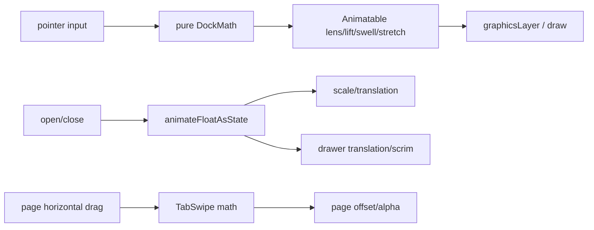

# HITA-Android shell 动效复刻设计

## 1. 基线

- 设备参考：`cn.limpu.hita` 3.1.2，versionCode `2026103101`。
- 源码基线：`HIT-A/HITA_Android` tag `v3.1.2`，commit `ac15007`。
- 3.1.2 验收只引用 3.1.2 源码；`TabSwipe.kt` 只在 3.3.0 出现，3.1.2 没有左右滑动切页。
- 3.3.0 TabSwipe 作为独立扩展实现，源码 `HIT-A/HITA_Android` tag `v3.3.0`（commit `81fe258`）。
- Dock 弹簧、抽屉时长、Haze/Backdrop 参数在 3.1.2 与 3.3.0 相同。

## 2. 范围

本次只做 shell 动效，不改插件协议：

- 抽屉：进度、内容缩放/位移、玻璃/非玻璃两套时间曲线。
- Dock：press/drag/release 状态机、lens 浮点索引、触感、四弹簧。
- 主题切换：风格选择后的整页重建；颜色过渡只在明确的组件上做。
- 3.3.0 TabSwipe：左右滑动切页，作为独立扩展，不混入 3.1.2 验收。
- 不在本次范围：Fragment pager 手势、未在 3.1.2 或 3.3.0 出现的动效。

## 3. 模块与契约

### 3.1 DrawerMotion

输入：`style`、`open`、`drawerWidthPx`、`density`。

输出：`progress`、`contentScale`、`contentOffsetPx`。

契约：

- 玻璃：打开 240ms `LinearOutSlowInEasing`；关闭 200ms `FastOutLinearInEasing`。
- 非玻璃：`spring(dampingRatio=0.9, stiffness=300)`。
- 玻璃内容缩放 `1 - progress * 0.008`，位移 `-10dp * progress`。
- 非玻璃内容缩放 `1 - progress * 0.2`，位移 `-drawerWidthPx * progress`。
- `progress=0` 时所有变换为恒等；`progress=1` 时抽屉完全展开。
- 违约处理：宽度 <= 0 时不计算位移，保持恒等。

状态机：

```text
CLOSED --open--> OPENING --settled--> OPEN
OPEN --close--> CLOSING --settled--> CLOSED
```

打开/关闭中途再次触发时，从当前 `progress` 继续；不重置到 0 或 1。

### 3.2 DockMotion

输入：触点 `x`、栏宽、项数、按压/拖拽/释放、速度。

纯函数：

- `dockIndexAt(x, width, count, padding)`：浮点索引。
- `rubberBand(delta, limit)`：越界阻尼。
- `flingIndex(lensTarget, velocityX, extent, pressedIndex, lastIndex, projectionSeconds)`：释放落点。
- `pressScale(swell, maxDimensionPx, maxGrowthPx)`：按下膨胀。

状态机：

```text
IDLE --press--> PRESSED --drag--> DRAGGING --release--> SETTLING --settle--> IDLE
PRESSED --release(no drag)--> SETTLING
```

弹簧：

- 跟手：`spring(1.0, 2740)`。
- 按下抬升/膨胀：`spring(0.8, 504)`。
- 落定：`spring(0.68, 158)`。

契约：

- `lens` 是浮点项索引，不是选中整数；视觉 lens 可跨项移动。
- 跨项时才发 `CLOCK_TICK`，不是每帧发。
- 释放后 `lens` 必定收敛到 `[0, lastIndex]` 的整数目标。
- 无目标页/无拖动时回弹，不切换页面。

### 3.3 StyleTransition

- 风格选择后写 `ThemeTools.STYLE`，重建 shell；不做跨页面共享元素。
- 颜色动画只用于明确的 `animateColorAsState` 组件，避免整树重组。

### 3.4 TabSwipe（3.3.0）

输入：当前索引、页数、水平位移、速度、屏宽。

纯函数：

- `commitDirection`：位移越过 `0.22 * width` 或速度越过 `560dp/s` 时提交；速度优先。
- `rubberBand`：首/尾页位移按 `0.30` 缩量，上限 `0.08 * width`。
- `exitTarget` / `enterSource`：提交后当前页继续推出，新页从对侧进入。
- `alpha`：位移到整屏宽时归零。

契约：

- 目标页不存在时一律回弹，不回绕。
- 时间表页禁用，避免与切周次手势冲突。
- 子级先消费水平手势时取消切页。
- 收尾单段 `150ms`；换页发生在当前页完全离屏的帧。
- `ShellTabSwipeTest` 覆盖提交方向、速度优先、边界、阻尼、端点与透明度。

## 4. 数据流



- 手势层只产生事件与目标值；纯函数负责判定；`Animatable` 负责帧。
- 绘制层读取动画状态，避免每帧重组页面内容。

## 5. 验收

### 5.1 静态

- 复用 `scripts/visual_diff.py`，同页面、同尺寸、tolerance 10。
- 阈值：内容区 ≤2.0%，header/dock ≤1.0%。
- 必测：Today classic、Today apple_glass、抽屉展开态。

### 5.2 动效

- 录制：`scripts/motion_capture.sh <package> <out.mp4>`。
- 抽帧：`ffmpeg -i out.mp4 -vf fps=60 frames/%04d.png`。
- 包络：`python3 scripts/motion_envelope.py frames`，输出逐帧差异与稳定帧。
- 抽屉验收：
  - 打开耗时 240ms ± 2 帧（玻璃），关闭 200ms ± 2 帧；
  - 内容 scale/translation 在打开结束帧回到目标；
  - 稳定后逐帧差异低于阈值。
- Dock 验收：
  - 按下后 280ms 内 lift/swell 达峰；
  - 跨项触感次数等于跨项次数；
  - 释放后 500ms 内 lens 收敛到整数项。
- 若设备无法 60fps 录屏，记录实际 fps，并把帧阈值换算为时间。

### 5.3 回归

- `ShellMotionTest` 必须覆盖：抽屉变换恒等/端点、dock 索引、橡皮筋、fling 落点、pressScale。
- 纯函数测试不依赖 Android。

## 6. 实现顺序

1. `ShellMotion.kt` 纯函数与单元测试。已实现。
2. 抽屉改为 `progress` 驱动，接 `contentScale/contentOffset`。已实现。
3. Dock 状态机与四弹簧。已实现，`ShellDock.kt`。
4. 录屏脚本基线采样，按帧校准。已采样，结果见 `docs/baselines/2026-11-21-shell-motion.md`。
5. 3.3.0 TabSwipe 独立实现，不混入 3.1.2 验收。已实现，`ShellTabSwipe.kt`。

## 7. 被否决方案

- 直接把 3.3.0 的 TabSwipe 搬进 3.1.2 基线：版本不一致，否决。
- 用 `AnimatedVisibility` 整体滑入代替抽屉 progress：无法复刻内容缩放/位移，否决。
- 只做颜色/圆角，不做弹簧：Dock 手势无法验收，否决。
- 在 Compose 每帧重组整页：性能不可控，否决。
