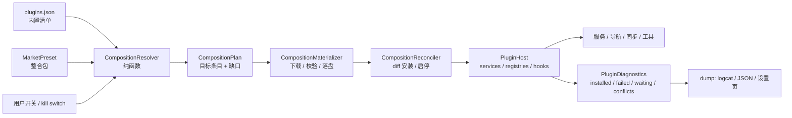

# 插件体系路线图：从“可注册”到“可计算、可拒绝、可诊断”

> 调研对象：`deepseek-harness`（下称 dsh）的 Cordis 运行时、能力 seam、profile/bundle 组合、工具流水线与启动诊断。
> 对照对象：本仓库 `:api` / `:kernel` / `:app` 的微内核、插件市场、整合包、运行时 UI 插件与宿主 ReAct agent。
> 本文只给方案，不改代码；所有“现状”均来自当前仓库，所有“目标设计”都标明与 dsh 的差异和 Android 侧适配理由。
>
> 记号约定：反引号只用于仓库中已经存在的类、函数、常量与配置字段；本方案新引入的类型、函数与流水线阶段用**粗体**或正文表述，避免把提案误读成现状。

## 0. 结论

本仓库已经独立实现了 dsh 最重要的两条底座：

- `PluginScope` 的撤销栈等价于 dsh 的 `ctx.effect()`，安装失败按相反顺序回滚；
- `PluginHost.failures` 做到单插件失败不影响其它插件，`MarketPreset.required` 已经区分必选与可选。

因此不需要再引入 Cordis，也不应该把 YAML、`!!js`、五模式事件总线搬到 Kotlin。真正值得借鉴的是 dsh 把三件事当成一等数据：

1. **组合**：产品跑什么，是一张可计算、可覆盖、可 dump 的表，而不是一串命令式安装步骤。
2. **依赖**：插件声明需要什么服务、提供什么服务，激活由可用性驱动，而不是靠清单顺序。
3. **拒绝**：不兼容的插件在导入代码之前就被拒绝；注册冲突、缺失依赖、加载失败都进入诊断，而不是静默降级。

本文把这些收敛为一个方案：**组合层、依赖层、工具层三层收敛，诊断横切**。改造点按依赖顺序落地，不追求一次重写。

## 1. dsh 调研结论

### 1.1 真正起作用的机制

| dsh 机制 | 具体做法 | 对本仓库的启示 |
|---|---|---|
| 服务上下文 | 插件把能力注册到稳定的 `ctx.<key>`，消费方按 key 注入，不 import 实现 | 已有 `ServiceKey`；缺的是“声明需要/提供”和激活顺序 |
| 能力 seam | Service Definition / Provider / Consumer 三角色；换 provider 即可换实现 | 本仓库的服务契约方向正确；第三方插件只声明 `compileOnly :api`，`:model` / `:component` 由 `:api` 的 `api project(...)` 传递，不依赖 `:app` 或其它插件 |
| 可逆副作用 | 注册通过 `ctx.effect()` / `ctx.on()` 安装，卸载时撤销 | 已有 `PluginScope` 撤销栈；不需要替换 |
| 组合分层 | profile 叠加有序 bundle、profile patch、home patch、`--patch`；按 id 覆盖整段配置；`--dump-config` 可查 | 本仓库的 preset 仍是命令式；需要 resolver + reconciler + dump |
| 启动失败策略 | required 失败终止；optional 失败只警告；缺失服务进入等待；被拒绝的插件永不导入 | 本仓库有 failure map；缺 waiting/conflict 分类和加载前拒绝 |
| 类型化工具 | defineTool 用 schema 同时生成模型描述与参数校验；`tools/pre-execute` 等形成策略流水线 | 本仓库 ReAct 工具仍是 `actionInput: String`，提示词手写；可直接借鉴 |
| 诊断目录 | config catalog、capability graph、tool catalog 由脚本生成并做新鲜度门禁 | 本仓库只有 `PluginHost.failures` 和手工 `API清单.md`；需要运行时 dump 与 CI 守卫 |

### 1.2 本仓库对照

| 能力 | 现状 | 判断 |
|---|---|---|
| 服务注册与撤销 | `PluginHost.PluginScope` 用 undo 栈，失败与卸载都回滚；`PluginHostTest.uninstallRestoresPreviousProvider` 覆盖了覆盖/恢复 | **保留**，这是正确底座 |
| 失败隔离 | `PluginHost.install` 捕获异常，写入 `failures`，继续安装其它插件 | **保留**，补 `waiting` / `conflict` 分类 |
| 组合与 preset | `PluginMarketViewModel.applyPreset` 边下载边安装边启停；三套状态分别落在 `PluginPrefs`、`PluginInstaller`、`UiPluginStore` | **改造**，收敛为 resolver / materializer / reconciler |
| 兼容性 | `requiresApi` 在实例化之后才检查；只有单向 `apiVersion <= HITA_API_VERSION`；UI 额外校验 `composeVersion` | **改造**，前移检查并补双向范围/ABI |
| 扩展点 | 只有注册表（nav / search / sync / tabs / service），没有决策拦截 | **有限增补**，只加具体流程需要的同步 hook |
| Agent 工具 | `ReActToolRegistry` 存 `SuspendingReActTool`；`ShellChatService.systemPrompt()` 手写 14 个工具说明；结果 `take(1800)`；`ReactPromptBuilder` 未被引用；`AgentToolRegistry` / `AgentToolExecutor` / `AgentOrchestrator` 是未引用的并行内核 | **改造 + 清理**，统一成类型化契约与流水线 |
| 诊断 | `PluginHost.failures()` 是唯一聚合视图；插件清单类名拼错只在运行时暴露；`verifyPluginBoundary` 只覆盖四个禁用类名 | **改造**，加诊断快照、组合 dump、索引/依赖守卫 |
| 信任模型 | HTTPS + sha256 + `verified_plugins.json` 白名单 + 不提供本地 APK 侧载 | **保留**，工具插件贡献继续沿用白名单 |

### 1.3 明确不迁移的部分

- **YAML profile + `!!js` 表达式**：Android 应用引入 JS 解释器与多层配置补丁，复杂度和攻击面都高于收益。用 JSON + Kotlin data class 表达同一张表即可。
- **五种事件分发模式与完整 Cordis 容器**：本仓库插件数量、生命周期复杂度都不需要通用事件框架。只保留一个同步 waterfall 和一个观察回调。
- **Node 的 runtime resolution / 模块解析注入**：这是 Node 生态专属问题；Android 侧对应的是 `DexClassLoader` 与 parent-first，不应类比实现。
- **per-agent isolate realm**：本仓库没有“每个会话一套插件树”的需求；先做全局组合，避免把作用域系统提前复杂化。
- **把宿主基础能力全部插件化**：`ThemeController`、`ReminderService`、`BackgroundTaskService` 由宿主 `provideGlobal` 是正确边界；它们涉及 Android 组件与权限，强行插件化只会增加间接层。

## 2. 目标方案

### 2.1 设计原则

1. **组合是数据，副作用分阶段**：纯函数算出目标状态；下载/校验/落盘单独一段；最后才做运行时 diff。任何一段失败都不破坏当前可用组合。
2. **依赖是声明，激活是波次**：插件元数据写明 requires/provides；内核按“依赖已满足”分批激活，未满足的进入 waiting，不当作失败。
3. **拒绝先于执行**：兼容性、ABI、设备约束在 `DexClassLoader` / `Class.forName` 之前判定；拒绝的插件不触发静态初始化。
4. **决策用最小 hook**：只在已有硬编码策略的流程上开一个同步 waterfall；没有第二个真实消费者就不新增 hook。
5. **工具契约类型化**：schema 同时驱动模型描述、参数解析与执行后呈现；不再手写工具目录，不再让 `actionInput` 裸奔。
6. **诊断是一等产物**：组合、服务提供者、冲突、等待、失败都能一键 dump；CI 守卫契约边界与索引格式。

### 2.2 目标结构



关键边界：

- **Resolver 不碰磁盘和网络**，只读当前状态快照，输出目标与缺口；可 JVM 单测。
- **Materializer 不碰运行中的 `PluginHost`**，只准备 artifact；失败时旧文件与旧插件保持原样。
- **Reconciler 不下载**，只根据 plan 与当前安装记录做 attach / enable / disable；每一步可重试。
- **PluginHost 不读市场索引**，只接收已经校验过的插件与元数据；启动路径和运行时安装路径共用同一套激活逻辑。

### 2.3 改造点总览

| 改造点 | 解决的问题 | 依赖 | 阶段 |
|---|---|---|---|
| A. 组合 resolver / materializer / reconciler | preset 命令式、三套状态、部分失败不可回滚 | 诊断骨架 | M2 |
| B. 依赖声明 + 波次激活 + provider 冲突 | 安装顺序决定成败、服务静默覆盖 | 无 | M1 |
| C. 加载前兼容 gate + 双向范围 / ABI | 被拒绝插件已经执行过代码 | 元数据（B 的 descriptor 可复用） | M0 |
| D. 最小决策 hook | 扩展点只能“加东西”，不能改决策 | 无 | M4 |
| E. ReAct 工具契约 + 执行流水线 | 手写提示词、字符串参数、无策略层 | 无 | M3 |
| F. 诊断与契约守卫 | 失败不可见、契约漂移 | 横切 | M0 起持续 |

## 3. 改造点

### 3.1 改造点 A：把 preset 收敛为“计划 + 备料 + 对账”

**现状**

`PluginMarketViewModel.applyPreset()` 在一个循环里完成三件事：从索引找 artifact、下载/安装、启用/停用。它同时维护三套状态：

- 内置插件：`app/src/main/assets/plugins.json` + `PluginPrefs` 的禁用集合；
- 运行时 dex：`PluginInstaller` 的 `installed.json` / `disabled.json`；
- 运行时 UI：`UiPluginStore` 的安装记录 + 禁用集合。

`MarketPreset` 的 `required` 只影响失败文案：required 失败时不写 `PresetStateStore.setActive`，optional 失败仍会切换；已经装了一半的插件不会回滚。旧组合的停用依赖 `previous` 与 `keep` 集合，且只在 `failures.isEmpty()` 时执行。结果是“当前组合”不是一个可查询的事实，而是三套存储加上 active id 的推断。

**目标设计**

引入四段式，替代 `applyPreset()` 的主体：

1. **CompositionResolver**：纯函数，输入 base entries、active preset、user overrides、kill switches、current install records，输出 **CompositionPlan**。
   - 每个条目带 `id`、`kind`（builtin/dex/ui）、`source`（BASE/PRESET/USER/SAFETY）、`enabled`、`required`。
   - 优先级：SAFETY > USER > PRESET > BASE；用户显式禁用优先于 preset 的启用，但若该条目在 preset 中 required，plan 标记“required 被用户禁用”，由 UI 提示，不静默反悔。
   - 输出缺口：缺 artifact、版本不符、未受信任、索引缺失；这些不是“失败”，而是 plan 的字段。
2. **CompositionMaterializer**：只为缺口准备 artifact。复用 `PluginInstaller.install()` 已有的 staging/backup/sha256 逻辑，但拆成“下载并校验到 staging”和“原子替换落盘”两段；在全部 required artifact 就绪之前，不触碰运行中的插件。
3. **CompositionReconciler**：读取 `PluginInstaller.installed()`、`UiPluginManager.installed()`、`BuiltinPluginManager.rows()`，与 plan 做 diff：
   - 必选条目先安装/启用；只有全部必选步骤成功后才停用旧组合独有条目。
     这样在 materializer 尚未落地时，失败不会先拆掉当前可用组合；UI 闪烁让位于可回滚性。
   - 停用失败视为激活失败，并按对账前快照回滚已完成的安装/启用。
   - 返回 `ReconcileReport(installed, enabled, disabled, skipped, rolledBack, failures, optionalFailures)`；
     report 写回 UI，不改变 plan。
4. **CompositionStore**：只持久化“意图”（active preset、用户覆盖、kill switch），实际安装状态继续由三个 manager 拥有；二者通过 resolver 合并。

新增 `dump()`：输出每个条目的 desired/actual、source、artifact 状态、失败原因。debug 包用广播触发，写入 logcat 与 `filesDir/diagnostics/composition.json`。

**与 dsh 的差异**：不引入 YAML 与层叠 patch 文件；`source` 枚举承担“哪一层写的”这一职责。不做任意 id 的插入/覆盖语法，避免配置图灵完备。

**涉及文件**

- `app/src/main/java/com/stupidtree/hitax/market/PluginMarketViewModel.kt` — 拆出 `applyPreset` 的解析、备料、对账；保留旧路径做 golden 对比。
- `app/src/main/java/com/stupidtree/hitax/market/MarketPlugin.kt` — `MarketPreset` / `PresetPluginRef` 增加 plan 所需字段的读取。
- `app/src/main/java/com/stupidtree/hitax/market/PresetStateStore.kt` — 只保留 active id / shell，不再承担组合事实。
- `app/src/main/java/com/stupidtree/hitax/market/PluginInstaller.kt` — 拆出 materialize 与 attach；复用 staging/backup。
- `app/src/main/java/com/stupidtree/hitax/uiplugin/UiPluginManager.kt` — 暴露可对账的安装/启用接口。
- `app/src/main/java/com/stupidtree/hitax/plugin/BuiltinPluginManager.kt` — 暴露 rows 与 setEnabled，供 reconciler 使用。
- `app/src/main/java/com/stupidtree/hitax/plugin/PluginCatalog.kt` — 提供 base entries 快照。
- `app/src/main/java/com/stupidtree/hitax/plugin/PluginPrefs.kt` — 用户覆盖的读取入口。
- `app/src/main/java/com/stupidtree/hitax/HApplication.kt` — 启动时先 resolve 再 reconcile，替换 `installAll` + `restore` 的散装顺序。

**验收方式**

- 新增 JVM 测试 **CompositionResolverTest**：同一输入多次 resolve 结果一致；USER 覆盖 PRESET；SAFETY 覆盖 USER；required 缺失时 plan 不进入 reconcile；旧 preset 的 golden 测试与当前 `applyPreset` 的启用集合一致。
- 新增 **CompositionReconcilerTest**：模拟“旧组合 A 切换到 B”，断言必选安装/启用成功后才停用 A 独有条目；
  required 失败时按对账前状态回滚，不留下新装/旧停的半成品。
- `./gradlew :app:testDebugUnitTest --tests "*Composition*"` 退出码 0。
- debug 包执行显式广播：
  `adb shell am broadcast -n io.github.kajimi16.ohmyhita/com.stupidtree.hitax.debug.PluginDiagnosticsReceiver -a com.stupidtree.hitax.DEBUG_DUMP_COMPOSITION`；
  logcat 中每条包含 `source=`、`desired=`、`actual=`；`filesDir/diagnostics/composition.json` 可解析。
- `./gradlew :kernel:test :api:test` 保持通过。

### 3.2 改造点 B：服务依赖声明、波次激活与显式 provider 冲突

**现状**

`Plugin` 只有 `id`、`requiresApi`、`displayName` 与安装钩子，没有“我需要哪个服务 / 我提供哪个服务”的声明。`PluginHost.installAll()` 按 `PluginCatalog.plugins()` 的顺序逐个安装；`PluginInstaller.restore()` 按 `installed.json` 顺序恢复。插件在 `install(ctx)` 里调用 `PluginContext.service(key)`，提供者尚未安装时得到 null，只能各自防御。

`PluginScope.provide()` 使用 `services.put(key.name, impl)`，同名服务静默覆盖，undo 时恢复上一个实现。`PluginHostTest.uninstallRestoresPreviousProvider` 把这个行为固定成了契约。对两个第三方插件都提供同一个服务的情况，没有冲突提示，谁最后安装谁生效。

**目标设计**

1. **用 sidecar 元数据声明依赖，不改 `Plugin` 接口**。内置插件在 `plugins.json` 的条目里增加 `requires` / `provides` 字符串数组；dex 插件在 `MarketPlugin` 索引记录里增加同名字段；UI 插件已经在 `assets/plugin.json` 里有 `capabilities`，补 `requires` / `provides`。字符串使用 `ServiceKey.name`，因为元数据要跨 dex/JSON 边界，不能引用 Kotlin 类型。
2. **内核接收 descriptor**：新增 **PluginDescriptor**(id, requires: Set<String>, provides: Set<String>)；保留现有 `PluginHost.install(plugin)` 作为“无声明”的兼容入口，新增 install(plugin, descriptor)。`PluginLoader.loadAndInstall` 接收已经解析好的 descriptor，不在 loader 里读 JSON。
3. **波次激活**：`PluginHost` 维护 availableServices、waiting、conflicts。每轮只激活 requires 全部满足的插件；激活成功后把 provides 加入 available，并重新检查 waiting。没有可激活项时，剩余插件进入 waiting，不算失败。全局服务（`provideGlobal`）先于所有插件进入 available。
4. **显式冲突**：`provideGlobal` 永远优先；插件尝试提供已由全局提供的 key 时，记录冲突并忽略该注册；两个插件提供同一 key 时，先激活者胜出，后来者的该次 `provide` 被拒绝并记录 **PluginConflict**，插件其余注册继续。冲突不是异常，但必须在诊断与 dump 中可见。
5. **提供者卸载**：不自动卸载依赖方（避免数据丢失）；依赖方保留安装状态，`service(key)` 返回 null，诊断标记 degraded，并触发一次 onServiceLost 观察回调（只读通知，不阻断）。

**与 dsh 的差异**：不实现 inject 的装饰器/代理注入；Kotlin 侧用显式 descriptor + 激活队列即可。不做“同一作用域重复 provider 直接启动失败”，因为本仓库要保证单插件失败不影响其它插件；改为“拒绝该次注册 + 记录冲突”。

**涉及文件**

- `api/src/main/java/com/stupidtree/hita/api/Plugin.kt` — 保持接口不变，补文档说明 descriptor 来源。
- `api/src/main/java/com/stupidtree/hita/api/PluginContext.kt` — 补 `service` 可用性观察或 onServiceLost 的契约说明。
- `api/src/main/java/com/stupidtree/hita/api/ServiceKey.kt` — 作为元数据字符串的权威来源。
- `kernel/src/main/java/com/stupidtree/hita/kernel/PluginHost.kt` — 激活队列、available/waiting/conflicts、冲突策略、诊断快照。
- `kernel/src/main/java/com/stupidtree/hita/kernel/PluginLoader.kt` — 接收 descriptor 并转交 host。
- `kernel/src/test/java/com/stupidtree/hita/kernel/PluginHostTest.kt` — 补依赖/冲突/等待/卸载提供者的用例。
- `app/src/main/java/com/stupidtree/hitax/plugin/PluginEntry.kt` — 解析 `requires` / `provides`。
- `app/src/main/java/com/stupidtree/hitax/plugin/PluginCatalog.kt` — 构造 descriptor。
- `app/src/main/java/com/stupidtree/hitax/market/MarketPlugin.kt` — 索引字段。
- `app/src/main/java/com/stupidtree/hitax/market/PluginInstaller.kt` — 恢复/安装时传入 descriptor。
- `app/src/main/assets/plugins.json` — 为内置插件补声明（课表/教务/资源/用户/θ）。

**验收方式**

- `PluginHostTest` 新增：提供者后安装时，消费者从 waiting 转为已安装；缺少提供者时留在 waiting 且不写入 `failures`；同一 key 两个提供者时先者胜、后者产生 **PluginConflict**；卸载提供者后依赖方仍在 `installedIds`，但诊断标记 degraded；`provideGlobal` 不被插件覆盖。
- `./gradlew :kernel:test` 退出码 0。
- 兼容性用例：不实现任何新接口、只在 `plugins.json` 增加字段的旧内置插件仍能安装；不声明 `requires` / `provides` 的 dex 插件按空集合处理。
- 诊断断言：`PluginHost.diagnostics()` 的 `waiting`、`conflicts`、`providers` 与测试构造一致。

### 3.3 改造点 C：兼容性检查前移到加载之前

**现状**

`PluginLoader.loadAndInstall()` 先 `DexClassLoader`，再 `Class.forName(entryClassName, true, loader)`，然后 `getDeclaredConstructor().newInstance()`，最后 `host.install(plugin)` 才检查 `plugin.requiresApi > HITA_API_VERSION`。内置路径 `PluginCatalog.instantiate()` 同样是 `Class.forName(..., true, ...)` 加构造，之后才进入 `PluginHost.install`。也就是说，“API 太新”的插件在拒绝之前已经执行了静态初始化与构造函数。

市场索引字段有 `apiVersion`、`minHostApi`，但没有 `maxHostApi`，也没有 API ABI 标识；UI 插件额外校验 `composeVersion`，是三条路径里最接近正确的。

**目标设计**

1. **纯函数 checkCompatibility(meta, host)**：返回 Compatible 或 Rejected(reasons)。输入包括 `minHostApi`、`maxHostApi`、`apiAbi`、`minSdk`、`composeVersion`；`HITA_API_VERSION` 继续作为人类可读的主版本。
2. **加载前 gate**：`PluginLoader.loadAndInstall` 增加 **PluginArtifactMeta** 参数；`PluginInstaller` 已经在下载后拿到 `MarketPlugin`，直接传入；`PluginCatalog.instantiate` 从 `PluginEntry` 构造同样的 meta。gate 在任何 `Class.forName` / `DexClassLoader` 之前执行。
3. **ABI 指纹**：由 `:api` 的公开 ABI 生成 `api-abi.txt`（Gradle 任务），发布插件时把哈希写入索引；宿主启动时比对。`HITA_API_VERSION` 负责语义版本，ABI 哈希负责“版本号没变但签名变了”的破坏性变更。
4. **双向范围**：`minHostApi` 之外补 `maxHostApi`，避免“未来宿主碰巧加载旧插件”的误判；缺省表示不设上限，与旧索引兼容。
5. **精确豁免**：单独放在 `app/src/main/assets/plugin_exemptions.json`，键为 `id@version`，值为允许的宿主版本列表；升级插件或宿主都不继承豁免。读取失败不影响启动，记录诊断。
6. **UI 路径对齐**：`UiPluginManager.installFile` 已经先读 `assets/plugin.json` 再落库，补 `maxHostApi` 与 `apiAbi` 校验；实际类加载仍在 `PluginUiActivity`，但拒绝发生在安装阶段。

**与 dsh 的差异**：dsh 的 engines.dsh / peerDependencies 是 npm 生态的范围匹配；Android 侧用整数 API + ABI 哈希 + 精确豁免，避免引入 semver 解析器。

**涉及文件**

- `kernel/src/main/java/com/stupidtree/hita/kernel/PluginLoader.kt` — 增加 meta 参数与加载前 gate。
- `kernel/src/test/java/com/stupidtree/hita/kernel/PluginLoaderTest.kt` — 补拒绝先于类初始化的用例。
- `api/src/main/java/com/stupidtree/hita/api/Plugin.kt` — `requiresApi` 语义与豁免说明。
- `app/src/main/java/com/stupidtree/hitax/plugin/PluginEntry.kt` — 读取 `maxHostApi` / `apiAbi`。
- `app/src/main/java/com/stupidtree/hitax/plugin/PluginCatalog.kt` — 构造 meta 并前移检查。
- `app/src/main/java/com/stupidtree/hitax/market/MarketPlugin.kt` — 索引字段。
- `app/src/main/java/com/stupidtree/hitax/market/PluginInstaller.kt` — 下载后、装载前调用 gate。
- `app/src/main/java/com/stupidtree/hitax/uiplugin/UiPluginManager.kt` — UI 元数据 gate。
- `app/src/main/assets/plugins.json` — 内置插件可选声明 `maxHostApi` / `apiAbi`。

**验收方式**

- 新增 **PluginCompatibilityTest**：`minHostApi` 过高、`maxHostApi` 过低、ABI 不匹配、`minSdk` 过高、`composeVersion` 不匹配分别返回对应原因；缺省字段按兼容处理。
- `PluginLoaderTest` 增加“类初始化标记”用例：构造一个测试类，其静态初始化会写标志；以不兼容 meta 调用 loader，断言标志未写、异常为兼容性拒绝而非 `ClassNotFoundException`。
- `UiPluginManager` 的安装测试：`apiVersion` 过高或 ABI 不匹配时不落库、不覆盖旧版本。
- `./gradlew :kernel:test :api:test` 退出码 0。
- `./gradlew :app:testDebugUnitTest --tests "*Compatibility*"` 退出码 0。

### 3.4 改造点 D：最小决策 hook，只开两个真实流程

**现状**

`:api` 与 `:kernel` 没有任何事件/拦截层；扩展点只有注册表。`HApplication` 的 `StupidSync.PushDelegate.saveData` 直接调用 `SyncCodec.save`；`ReminderReceiver.notify` 直接构建 `NotificationCompat`。这两处都是“策略写死在宿主”的典型：插件只能整体替换 `SyncCodec` 或 `ReminderService`，不能只改一次决策。

**目标设计**

1. 在 `:api` 增加一个同步 waterfall（环绕式拦截）：

```kotlin
fun interface Decision<T> {
    fun handle(value: T, next: (T) -> T): T
}
```

2. `PluginContext` 暴露 hooks，注册返回撤销句柄，由 `PluginScope` 统一回滚；监听器按注册顺序执行，不调用 `next()` 即短路。
3. 只开两个试点，且都放在宿主侧、不修改 `:sync` 模块：
   - **sync/pull-record**：`PushDelegate.saveData` 在调用 `SyncCodec.save` 之前，把 `(key, ids, data)` 交给 hook；默认原样返回。用于插件把远端整表覆盖改成字段级合并。
   - **reminder/notify**：`ReminderReceiver.notify` 在构建通知之前，把 `(title, text, priority)` 交给 hook；默认原样返回。用于插件追加课程/考试上下文。
4. 规则写进文档：新增 hook 必须同时给出第二个真实消费者和回滚方式；否则直接用服务替换，不建 hook。
5. 不实现异步事件总线、不做 `emit` 广播；观察需求用 **PluginDiagnostics** 或回调，避免两套机制并存。

**与 dsh 的差异**：dsh 的 waterfall 是 Cordis 事件系统的一部分，有五种分发模式；这里只取“环绕 + 可短路”这一种，Kotlin 同步接口足够覆盖上述两个流程。

**涉及文件**

- `api/src/main/java/com/stupidtree/hita/api/PluginContext.kt` — 增加 hooks 入口。
- `kernel/src/main/java/com/stupidtree/hita/kernel/PluginHost.kt` — hook 注册、顺序执行、撤销。
- `kernel/src/test/java/com/stupidtree/hita/kernel/PluginHostTest.kt` — 顺序、短路、卸载撤销。
- `app/src/main/java/com/stupidtree/hitax/HApplication.kt` — sync/pull-record 试点。
- `app/src/main/java/com/stupidtree/hitax/reminder/ReminderReceiver.kt` — reminder/notify 试点。
- `api/src/main/java/com/stupidtree/hita/api/SyncCodec.kt` — 在注释中说明合并不再由 codec 独占。
- `app/src/main/java/com/stupidtree/hitax/reminder/ReminderRules.kt` — 如 hook 改写标题/正文，复用现有长度校验。

**验收方式**

- `PluginHostTest` 新增：两个 hook 按注册顺序执行；第一个不调用 `next()` 时第二个不执行；插件卸载后 hook 不再触发；hook 抛异常时回退默认值并记录诊断。
- sync 试点单测：默认 hook 下 `saveData` 与当前行为一致；合并 hook 返回的 payload 被传给 `SyncCodec.save`。
- reminder 试点单测：默认 hook 下标题/正文不变；改写后仍经过 `ReminderRules` 的长度校验。
- `./gradlew :kernel:test :api:test` 退出码 0。
- `./gradlew :app:testDebugUnitTest --tests "*Hook*"` 退出码 0。

### 3.5 改造点 E：统一 ReAct 工具契约与执行流水线

**现状**

线上路径是 `ShellChatService` + `ReActToolRegistry`：

- `ReActToolRegistry` 是 `MutableMap<String, SuspendingReActTool>`，注册只给名字与函数；
- `SuspendingReActTool` 的输入是 `ReActToolInput`，动作参数是 `actionInput: String`，由每个工具自行解析；
- `ShellChatService.systemPrompt()` 手写 14 个工具的说明与示例，和 `ReActToolRegistry.createDefault()` 的注册列表是两份事实；
- `ShellChatService` 对观察结果统一 `take(1800)`，没有按工具区分；
- `ReactPromptBuilder` 未被引用；
- `AgentToolRegistry`、`AgentToolExecutor`、`AgentOrchestrator` 在 `app/src/main` 内没有外部引用，是未启用的并行内核。

**目标设计**

1. **一个类型化工具契约**：name、description、parameters（JSON Schema）、output、execute(args, ctx)、timeoutMs、retrySafety、maxObservationChars、presentCall / presentResult。参数在执行前由 registry 校验，非法输入返回结构化错误，不再让工具自己从字符串里猜。
2. **一个注册表**：**ToolRegistry** 同时提供 catalog()（生成给模型的工具目录）与 execute(name, rawArgs)（解析 + 校验 + 分发）。`ShellChatService` 不再手写 `systemPrompt()` 的工具段，改为 catalog()；删除 `ReactPromptBuilder` 或把它降级为纯模板拼装。
3. **固定流水线**：preExecute（allow/deny/ask）→ execute → postExecute（脱敏、截断、附加资源卡片）→ 结果。超时/重试/取消复用 `AgentToolExecutor` 已经实现的能力，不再维护第二套。
4. **清理并行内核**：二选一，不保留两套。推荐以 `AgentTool` 的取消/超时语义为底层，把 `ReActToolRegistry` 改成它的适配器；迁移完 14 个工具后删除 `AgentToolRegistry` 与 `AgentOrchestrator` 的无引用代码。
5. **插件贡献工具分两段，避免 `:api` 反向依赖 `:app`**：
   - **E1（宿主内部统一）**：先完成 app 侧的 **ToolRegistry** 与流水线，14 个工具仍由宿主注册；这一步不向插件开放。
   - **E2（插件贡献）**：在 `:api` 增加最小工具描述 **PluginToolSpec**（name、description、parametersSchemaJson、outputSchemaJson、maxObservationChars、timeoutMs）与 **PluginToolHandler**（inputJson: String 返回 String）；`PluginContext` 暴露 tools，插件的 spec/handler 只使用字符串与 JSON，不引用 `AgentTool`、**ToolRegistry** 或任何 `:app` 类型。app 侧适配器把 spec 转成内部类型化定义，并在适配器内完成 schema 校验、超时与截断。
   - 只允许 `verified_plugins.json` 中的插件注册；默认不暴露危险工具；工具 schema 由注册表生成，插件不能直接写提示词。

**与 dsh 的差异**：不引入 PTC 执行器、不引入 run_code 程序传输；只取 defineTool 的 schema 驱动与 pre/post 策略层。Android 侧工具调用仍然走宿主进程，安全边界靠白名单，不靠 schema。

**涉及文件**

- `app/src/main/java/com/stupidtree/hitax/agent/tools/ReActToolRegistry.kt` — 改为类型化注册表或适配器，并迁移 14 个工具的 schema 与元数据。
- `app/src/main/java/com/stupidtree/hitax/agent/tools/ReActTool.kt` — 输入从裸字符串改为带 schema 的参数对象。
- `app/src/main/java/com/stupidtree/hitax/agent/llm/ShellChatService.kt` — 用 catalog 生成提示词，移除手写工具段；统一错误/截断。
- `app/src/main/java/com/stupidtree/hitax/agent/llm/ReactPromptBuilder.kt` — 删除或降级为模板拼装。
- `app/src/main/java/com/stupidtree/hitax/agent/core/AgentTool.kt` — 作为类型化契约的底层。
- `app/src/main/java/com/stupidtree/hitax/agent/core/AgentToolExecutor.kt` — 复用超时/重试/取消。
- `app/src/main/java/com/stupidtree/hitax/agent/core/AgentToolRegistry.kt` — 迁移后删除重复注册表。
- `app/src/main/java/com/stupidtree/hitax/agent/core/AgentOrchestrator.kt` — 确认无引用后删除。
- `api/src/main/java/com/stupidtree/hita/api/PluginContext.kt` — 工具贡献入口（E2，仅字符串/JSON spec，不引用 app 类型）。

**验收方式**

- **E1**：新增 JVM 测试 **ToolRegistryTest**：catalog() 包含全部已注册工具且与注册表一致；必填/类型/枚举校验失败返回 INVALID_ARGS；未知工具返回结构化错误；maxObservationChars 截断带标记；preExecute 拒绝时不执行工具主体。
- **E1**：prompt 快照测试：给定 registry，`ShellChatService` 生成的 system prompt 包含 catalog() 的每一项，且不再包含手写字符串。
- **E2**：在 `:api` 的测试源里只依赖 **PluginToolSpec** / **PluginToolHandler** 构造一个假工具，app 侧适配器注册后 catalog() 可见；卸载插件后从 catalog() 与执行集合消失。
- **E2 边界**：`rg "com\\.stupidtree\\.hitax\\.agent" api/src` 无结果；`:api` 的编译类路径不包含 `:app`；`./gradlew :api:test` 退出码 0。
- `./gradlew :app:testDebugUnitTest --tests "*Tool*"` 退出码 0。
- 设备冒烟：`ShellChatService` 对 `get_timetable`、`web_search` 各执行一次，logcat 中工具名、参数校验结果、截断长度与 registry 元数据一致。

### 3.6 改造点 F：诊断快照与契约守卫

**现状**

`PluginHost.failures()` 是唯一聚合视图；`PluginInstaller` 只写 logcat；`plugins.json` 里的类名拼错只在运行时 `ClassNotFoundException`；`verifyPluginBoundary` 只检查四个禁用类名；`docs/api/plugin-api.md` 与 `API清单.md` 靠手工维护。组合、服务提供者、冲突、等待都没有统一出口。

**目标设计**

1. **PluginDiagnostics**：`PluginHost.diagnostics()` 返回不可变快照：
   - `installed`：id、来源（builtin/dex/ui）、版本、descriptor；
   - `failed`：id、阶段（metadata/class/init/install）、原因；
   - `waiting`：id、缺失的 requires；
   - `providers`：service key → provider id / global；
   - `conflicts`：key、已有 provider、被拒绝的 provider；
   - `degraded`：提供者已卸载的依赖方。
2. **组合 dump**：**CompositionResolver** 与 **Reconciler** 提供 dump()，与 **PluginDiagnostics** 合并为一份 `diagnostics.json`；debug 包通过广播触发，release 包只在设置页“导出诊断”里生成。
3. **CI 守卫**：
   - 扩展 `:app:verifyPluginBoundary`：除了禁用类名，还用**显式 allowlist** 检查插件模块依赖，按当前真实依赖逐模块列出——`plugin-hita`：`:api`、`:model`、`:style`、`:component`、`:user`、`:sync`；`plugin-eas`：`:api`、`:model`、`:component`、`:style`、`:user`、`:sync`；`plugin-resource`：`:api`、`:model`、`:component`、`:style`；`plugin-user`：`:api`、`:model`、`:user`、`:component`、`:style`、`:sync`；`plugin-ui-*`：`compileOnly :api` 与 Compose。任何插件模块禁止依赖 `:app` 或另一插件模块。第三方 dex/UI 插件在构建侧只声明 `compileOnly :api`；`:model` / `:component` 由 `:api` 的 `api project(...)` 传递，不单独声明，也不套用宿主内插件的 allowlist。
   - 新增 `:verifyMarketIndex`：解析 `market/index.json`，校验 id 唯一、sha256 格式、`apiVersion` / `minHostApi` / `maxHostApi` 合理、preset 引用存在；
   - 内置 `plugins.json` 校验：id 唯一、class 非空、requires/provides 是已知 `ServiceKey.name` 的子集。
4. **文档**：`docs/api/plugin-api.md` 保持权威；后续可从 `ServiceKey` 与 descriptor 生成“能力 → 提供者 → 消费者”表，作为 CI 新鲜度检查。

**与 dsh 的差异**：不生成完整 config catalog / module graph；先做运行时诊断与两个 CI 守卫，等 descriptor 稳定后再考虑生成文档。

**涉及文件**

- `kernel/src/main/java/com/stupidtree/hita/kernel/PluginHost.kt` — diagnostics 快照。
- `kernel/src/test/java/com/stupidtree/hita/kernel/PluginHostTest.kt` — 快照字段断言。
- `app/src/main/java/com/stupidtree/hitax/HApplication.kt` — debug 广播与诊断文件写入。
- `app/build.gradle` — 扩展 `verifyPluginBoundary`，新增索引校验任务。
- `app/src/main/assets/plugins.json` — 清单校验输入。
- `market/index.json` — 索引校验输入。
- `docs/api/plugin-api.md` — 契约文档同步。
- `app/src/main/java/com/stupidtree/hitax/market/MarketPlugin.kt` — 索引字段解析。

**验收方式**

- `PluginHostTest` 新增：构造 installed/failed/waiting/conflict/degraded 五种状态，断言 `diagnostics()` 的字段与顺序稳定；JSON 序列化后能反序列化。
- debug 包执行显式广播：
  `adb shell am broadcast -n io.github.kajimi16.ohmyhita/com.stupidtree.hitax.debug.PluginDiagnosticsReceiver -a com.stupidtree.hitax.DEBUG_DUMP_PLUGINS`；
  logcat 与 `filesDir/diagnostics/plugins.json` 均包含 `installed`、`failed`、`waiting`、`providers`、`conflicts`。
- `./gradlew :app:verifyPluginBoundary` 退出码 0；故意在一个插件模块里加 `implementation project(':app')`，任务必须失败并指出模块。
- `./gradlew :verifyMarketIndex` 退出码 0；把 `market/index.json` 的 sha256 改成非十六进制，任务必须失败。
- `./gradlew :kernel:test :api:test` 退出码 0。

## 4. 落地顺序

不按工作量排，按依赖与可回滚性排。每个里程碑都能单独合并、单独回滚。

### M0：观测与拒绝（改造点 F 骨架 + C）

- 先做 **PluginDiagnostics** 的最小字段与 checkCompatibility 纯函数，再做加载前 gate。
- 原因：后续所有改造都需要“失败/等待/冲突可见”，而兼容性 gate 是唯一涉及“代码已经执行”的安全问题，优先消除。
- 回滚：诊断是只读新增；gate 失败只影响不兼容插件，保留 `requiresApi` 旧检查作为双保险。

### M1：依赖与激活（改造点 B）

- 先在内核完成 descriptor、波次激活、冲突策略与 waiting 诊断；再让 `PluginCatalog` / `PluginInstaller` 传入声明。
- 原因：组合 reconciler 需要知道“安装之后是否真的激活”，依赖层先稳定，M2 才不会把安装顺序问题误判为组合问题。
- 回滚：无声明插件按空集合处理，行为与当前一致；冲突策略可用开关退回“后装覆盖”。

### M2：组合对账（改造点 A）

- 先抽 resolver 纯函数与 golden 测试，再抽 materializer，最后替换 `applyPreset` 主体；旧路径保留一个版本做对照。
- 原因：这是用户可见改动最大的一步，必须在 M0 的诊断与 M1 的激活语义之上做，否则失败无法归因。
- 回滚：feature flag 切回旧 `applyPreset`；三套存储格式不变，reconciler 只是新的读写方。

### M3：Agent 工具契约（改造点 E）

- 与 M1/M2 文件冲突小，可并行；分两段：
  - **M3a（E1）**：统一 registry 与 schema，迁移 14 个工具，删除未引用的并行内核；工具仍由宿主注册。
  - **M3b（E2）**：在 `:api` 增加 **PluginToolSpec** / **PluginToolHandler** 与 `PluginContext.tools`，app 侧适配器接入内部 registry；只在 `:api` 契约稳定、白名单机制可用后开启。
- 原因：这是当前产品迭代最活跃的区域，独立于市场组合；先做 E1 能立刻减少“提示词/注册表两份事实”的漂移，E2 再解决跨模块贡献而不破坏依赖方向。
- 回滚：`ShellChatService` 保留旧 `actionInput` 适配器一个版本；E1 用开关启用；E2 关闭 `PluginContext.tools` 即回到“宿主独有工具”。

### M4：决策 hook（改造点 D）

- 最后做，且只开 sync/pull-record 与 reminder/notify 两个试点。
- 原因：hook 是“有第二个真实消费者才成立”的机制；在组合、依赖、工具稳定之前加，容易变成无消费者的框架。
- 回滚：hook 注册随插件撤销；默认无监听器时行为与当前完全一致。

## 5. 风险与对策

| 风险 | 说明 | 对策 |
|---|---|---|
| API 二进制兼容 | 给 `Plugin` 增加抽象成员会让旧 dex 插件链接失败 | 不改 `Plugin` 接口；依赖用 sidecar descriptor；`PluginContext` 只加成员（由内核实现） |
| 类初始化副作用 | 兼容性检查前移后，测试必须证明被拒绝的类没有执行 `<clinit>` | 用静态标记测试；loader 的 gate 在任何 `Class.forName` 之前 |
| 组合切换半途失败 | 下载失败、哈希失败、安装失败可能留下部分状态 | materialize 与 reconcile 分离；required 未就绪不开始 reconcile；复用 `PluginInstaller` 的 staging/backup |
| 用户状态迁移 | 三套存储格式已经存在，直接替换会丢“用户禁用”意图 | resolver 先读旧存储；**CompositionStore** 只新增意图，不迁移文件；golden 测试覆盖旧 preset |
| provider 冲突策略变化 | 现有插件可能依赖“后装覆盖” | 默认记录冲突并拒绝后来者，但提供兼容开关；在 `API清单.md` 与 `docs/api/plugin-api.md` 标明行为变更 |
| 工具插件攻击面 | 同进程、完整权限，schema 不是安全边界 | 只允许 `verified_plugins.json` 白名单注册；默认不暴露危险工具；安装前提示能力范围 |
| hook 滥用 | 每个流程都开 hook 会回到通用事件总线 | 文档规则：必须有第二个真实消费者；只允许同步 waterfall；观察走诊断 |
| 测试成本 | 组合与激活涉及多状态 | resolver/compatibility 是纯函数，优先 JVM 测试；Android 侧只测 manager 的 diff 与幂等 |

## 6. 完成定义

- `docs/plugin-roadmap.md` 中每个改造点都有“现状 / 目标设计 / 涉及文件 / 验收方式”，且涉及文件路径真实存在、引用的符号可在仓库中检索到。
- 方案只保留一条主线：M0 → M1 → M2 → M3 → M4；每个里程碑有独立回滚方式，不要求一次性重写。
- 最终状态满足四件事：
  1. 组合可由纯函数计算并 dump；
  2. 插件依赖可声明、激活可等待、冲突可见；
  3. 不兼容插件在加载前被拒绝；
  4. Agent 工具由 schema 驱动；插件贡献只在 `:api` 的最小工具 spec 与 app 侧适配器落地后开启，并受白名单约束。
- 不引入 YAML、`!!js`、通用事件总线或第二套工具注册表；已有 `PluginScope`、`provideGlobal`、sha256/白名单、UI capability 回退保持不变。

## 6.1 当前实现进度（2026-11）

- **M0 拒绝与诊断**：完成。加载前兼容 gate、ABI 指纹、精确豁免、内核诊断快照、debug dump 均已在生产路径。
- **M1 依赖与激活**：完成。descriptor 的 `requires` 驱动 waiting/波次激活，provider 冲突可见；`origin` 标记 builtin/dex，工具白名单不再按 id 猜测来源。
- **M2 组合对账**：完成。resolver/reconciler/dump、kind-scoped 安全开关、必选失败回滚、
  `CompositionMaterializer`（DEX/UI prepare 与 attach 分离）、启动时按 active preset 重放均已落地。
- **M3a 宿主工具契约**：完成。schema 驱动的 catalog/validate/timeout/truncate、output schema 元数据、
  retrySafe（含一次安全重试）、presentCall/presentResult、资源卡片回传与渲染、生产 guard/脱敏、
  单次 JSON 解析 + 14 个工具参数对象化已接入。不再保留第二套工具注册表。
- **M3b 插件工具**：完成。`PluginToolSpec` / `PluginToolHandler` 由内核记录 origin、校验 spec、随卸载撤销；
  `:api` 不引用 `:app` 工具类型。
- **M4 决策 hook**：完成。两个试点已接线；hook 异常回退原值并进入诊断，提醒 payload 重新过长度/优先级收敛，
  同步 hook 禁止重定向 key/ids。
- **F 诊断与守卫**：完成。运行时 diagnostics/composition 导出、hook/tool/declaredProvides 诊断、
  market/boundary/ABI 守卫均已落地。

剩余事项：真机整合包切换/AI 资源卡片交互需要真实索引与登录环境；
UI 安装已补旧 APK 备份/恢复，但进程被杀时仍非跨进程事务。

可执行任务拆分、Dumate 交接格式与验收命令见
[`2026-11-18-plugin-remaining-work.md`](plans/2026-11-18-plugin-remaining-work.md)。

## 7. 参考

- dsh 架构：<https://github.com/deepseek-ai/deepseek-harness/blob/master/docs/architecture.zh.md>
- Cordis 入门：<https://github.com/deepseek-ai/deepseek-harness/blob/master/docs/cordis-primer.zh.md>
- 能力 seam：<https://github.com/deepseek-ai/deepseek-harness/blob/master/docs/capability-seams.zh.md>
- 扩展实操手册：<https://github.com/deepseek-ai/deepseek-harness/blob/master/docs/cookbook/extension-cookbook.zh.md>
- 工具子系统：<https://github.com/deepseek-ai/deepseek-harness/blob/master/docs/subsystems/tools.zh.md>
- app-boot 启动与失败策略：<https://github.com/deepseek-ai/deepseek-harness/blob/master/packages/boot/app-boot/README.zh.md>
